# AI 쇼핑 관심도 시계열 분석 리포트 — Google Trends 2021-10 ~ 2026-10

> **요약**
> - 미국 'AI shopping' 검색 관심은 2023~24년 주 +1.4%로 천천히 늘다가, 2025년에 주 +6.0%(약 12주마다 2배)로 급증했다. 2026년 상반기에는 증가 속도가 주 +0.9%로 크게 느려졌다.
> - 급등한 주는 AI 쇼핑 기능 발표 직후(ChatGPT agent, ChatGPT 쇼핑 리서치 등)와 블랙프라이데이 주에 몰려 있다. 블랙프라이데이 주에는 직전 4주 평균의 1.2~1.5배가 되는데, 일반 온라인 쇼핑과 비슷한 크기다.
> - 2026-07-12 주에 −74% 급락했다. 하지만 대형 검색어와 독립 측정(위키백과 조회수)에는 같은 하락이 없어서, 실제 관심 감소보다 측정 쪽 변화일 가능성이 크다고 판단했다.
> - 한국 'AI 쇼핑'은 미국보다 약 20주 늦게 올라섰고, 국내 플랫폼의 AI 쇼핑 기능 출시 시점에 맞춰 움직였다.

---

## 1. 분석 주제 및 선정 이유

- **주제**: 'AI를 활용한 쇼핑'에 대한 사람들의 관심이 시간에 따라 어떻게 변했는가.
- **선정 이유**
  - 2024~2025년에 큰 서비스들이 AI 쇼핑 기능을 잇달아 내놓았다. Amazon Rufus(쇼핑 도우미), Perplexity·ChatGPT의 상품 검색·비교, ChatGPT agent(대신 구매), 결제 표준(Google AP2, OpenAI ACP) 등이다.
  - 기능이 쏟아진 만큼 사람들의 관심도 실제로 늘었는지, 언제 늘었는지, 어떤 계기와 맞물렸는지를 데이터로 확인하고자 했다.
- **관심의 대리 지표**: 검색 관심도(Google Trends). 검색은 '알아보려는 행동'의 흔적이라 관심의 크기와 시점을 보여 준다. 다만 실제 사용량이나 구매 건수는 아니다(9절 한계).

## 2. 분석 질문

| # | 질문 | 성격 | 답하는 곳 |
|---|---|---|---|
| Q1 | 미국에서 'AI shopping' 검색 관심은 언제부터, 얼마나 빠르게 커졌나? | 그래프로 확인 | 그림 1 · 2 |
| Q2 | 관심이 급등한 시점은 언제이고, AI 쇼핑 기능 발표나 쇼핑 시즌과 겹치나? | 추가 해석 필요 | 그림 3 |
| Q3 | 관심의 내용이 바뀌었나? 일반어에서 구체적 서비스·개념(ChatGPT shopping, agentic commerce)으로 옮겨 갔나? | 그래프로 확인 | 그림 4 |
| Q4 | 2026년 7월 중순의 급락은 실제 관심 감소인가, 측정 방식의 변화인가? | 추가 해석 필요 | 그림 5 · 6 |
| Q5 | 한국도 미국과 같은 흐름인가? 시차가 있나? | 그래프로 확인 | 그림 7 |

## 3. 데이터 설명

### 3-1. 출처 · 기간 · 규모

| 데이터 | 출처 | 기간 · 단위 | 데이터 수 | 역할 |
|---|---|---|---|---|
| 미국 AI 쇼핑 검색어 5종 | Google Trends(미국, 웹 검색) | 2021-10-24 ~ 2026-10-18 · 주간(일요일 시작) | 261주 × 5개 검색어 | **주 데이터** |
| 대조: 비AI 쇼핑 소량 검색어 4종 | Google Trends(미국) | 같은 기간 · 주간 | 261주 × 4 | 급락 검증 |
| 대조: 대형 일반 검색어 3종 | Google Trends(미국) | 같은 기간 · 주간 | 261주 × 3 | 급락 검증 |
| 한국 'AI 쇼핑' | Google Trends(한국) | 같은 기간 · 주간 | 261주 | 한국 비교 |
| 미국 일간 3종 | Google Trends(미국) | 2026-05-01 ~ 2026-09-30 · 일간 | 153일 × 3 | 급락 시점 · 요일 패턴 |
| 위키백과 조회수 2개 문서 | Wikimedia Pageviews API(영어, 사용자 조회) | 2025-01-01(또는 문서 생성일) ~ 2026-10-25 · 일간 | 663일 · 317일 | 독립 측정 교차 확인 |

- 주 데이터의 검색어는 AI shopping · AI shopping assistant · ChatGPT shopping · agentic commerce · Amazon Rufus다. 한 번에 요청했기 때문에 다섯 검색어의 높이를 서로 비교할 수 있다.
- 수집 방법: `collect.py`(pytrends · Wikimedia REST API). 수집 시각은 `data/metadata.json`에 남겼다(2026-10-26).
- 출처·라이선스 주의: Google Trends는 Google 서비스 약관에 따라 출처 표기("Data source: Google Trends")가 필요하고, pytrends는 비공식 클라이언트다. Wikimedia 조회수는 CC0다. 자세한 내용은 [README](README.md#데이터-출처--수집-방법--라이선스)에 있다.

### 3-2. 값 읽는 법(Google Trends)

- 0~100 사이의 **상대 지수**다. 요청한 기간·지역 안의 최댓값을 100으로 둔다. 주 데이터의 100은 'AI shopping'의 2026-06-07 주다.
- 같은 요청 안의 검색어끼리만 높이를 비교할 수 있다. 요청이 다르면 기준이 달라서 모양과 시점만 비교한다.
- **0은 '검색이 없음'이 아니라 '검색량이 임계값 미만'**이라는 뜻이다.
- 표본 기반이라 다시 받으면 값이 조금 달라진다. 같은 'AI shopping'을 두 요청에서 받아 비교하니 상관계수가 0.997이었다.

### 3-3. 컬럼

| 컬럼 | 의미 |
|---|---|
| `date` | 주 시작일(일요일) 또는 날짜 |
| 검색어 이름(예: `AI shopping`) | 해당 주의 검색 관심도(0~100 정수) |
| `isPartial` | 아직 진행 중인 기간이면 True |
| `views`(위키백과) | 하루 사용자 조회 수 |

## 4. 데이터 정제

### 4-1. 기본 정보 확인 (`outputs/data_quality.csv`)

| 파일 | 행 | 기간 | 날짜 누락 | NaN | 0인 칸 | 제거한 진행 중 기간 |
|---|---|---|---|---|---|---|
| trends_us_weekly | 261 | 2021-10-24 ~ 2026-10-18 | 0 | 0 | 614 | 2026-10-25 주 |
| trends_us_controls_longtail | 261 | 같은 기간 | 0 | 0 | 157 | 2026-10-25 주 |
| trends_us_controls_highvol | 261 | 같은 기간 | 0 | 0 | 58 | 2026-10-25 주 |
| trends_kr_weekly | 261 | 같은 기간 | 0 | 0 | 193 | 2026-10-25 주 |
| trends_us_daily_2026 | 153 | 2026-05-01 ~ 2026-09-30 | 0 | 0 | 0 | - |
| wiki_en_agentic_commerce | 317 | 2025-12-13 ~ 2026-10-25 | 0 | 0 | 0 | - |
| wiki_en_online_shopping | 663 | 2025-01-01 ~ 2026-10-25 | 0 | 0 | 0 | - |

- 날짜 누락은 시작일~종료일을 7일(일간은 1일) 간격으로 채운 달력과 대조해 확인했다.

### 4-2. 결측치 처리 기준

| 대상 | 기준 | 처리 |
|---|---|---|
| 날짜 누락 · NaN | 0건 | 처리할 것 없음 |
| 진행 중인 마지막 주(2026-10-25 주, `isPartial=True`) | 하루~이틀치만 반영돼 실제보다 낮게 보인다 | **제거**(262 → 261주) |
| 값 0 | 결측이 아니라 '임계값 미만'(아주 낮음)이라는 정보다 | **0 그대로 유지**. 단, 변화율은 직전 값이 5 미만이면 계산하지 않음(0~4는 반올림 오차가 커서). 로그 눈금 그림에서는 0.2 미만 생략 |
| 0의 분포 | 미국 'AI shopping'은 56주가 0이고 모두 2023년 이전(P0 구간의 93%). 한국 'AI 쇼핑'은 193주가 0 | 2023년 이전은 '관심 거의 없음' 구간으로 해석. 한국은 측정 한계로 9절에 기록 |
| 위키백과 일간 → 주간 | 7일이 다 찬 주만 사용 | 양 끝의 덜 찬 주 제외 |

### 4-3. 이상치 처리 기준

| 대상 | 기준 | 처리 |
|---|---|---|
| 급등 주 | 직전 8주 중앙값 대비 로그 비율의 로버스트 z 점수(중앙값·MAD 기준) ≥ 2.5이고 값 ≥ 5 | **삭제하지 않고 표시**(10주). 급등은 분석 대상인 '사건'이다. 추세는 이동평균으로 노이즈를 걸러 본다 |
| 구조 단절(2026-07-12 주, AI 관련 검색어가 한꺼번에 반토막) | 이상치 한 점이 아니라 수준 자체가 이동한 것 | **보정·삭제하지 않고 구간을 나눔**. 추세·분해·예측 검증은 2026-07-05 주까지만 쓰고, 이동평균도 단절을 넘지 않게 앞뒤를 따로 계산한다. 급락 전후 비교에서는 전환 주를 뺀다. 원인 검증은 Q4에서 한다 |

### 4-4. 집계 단위 · 스케일 선택 근거

- **주 단위**를 택한 이유는 세 가지다.
  - Google Trends는 9개월 이하 기간만 일간으로 준다. 5년 흐름은 주간으로만 받을 수 있다.
  - 일간 데이터로 확인한 'AI shopping'의 요일 차이가 −4~+6%로 작다(그림 6). 주 단위로 묶어도 잃는 정보가 적다.
- **분기 평균**은 2025년의 계단식 변화를 한눈에 보려고 추가했다(그림 2).
- **로그 눈금**도 추가했다. 선형 눈금에서는 2023~24년 값(1~5)이 바닥에 깔려 '변화가 없는 것처럼' 보인다. 로그 눈금에서는 같은 기울기가 같은 증가 속도라 시기별 성장 속도를 비교할 수 있다(그림 1 아래).

## 5. 적용한 시계열 분석 기법

| 기법 | 어떻게 | 왜 | 그림·표 |
|---|---|---|---|
| 이동평균 | 4주·13주, 가운데 정렬·단절 앞뒤 구간별(그림), 직전 N주 후행 평균(대시보드) | 주간 노이즈를 걸러 추세를 보기 위해 | 그림 1 · 4 · 7 |
| 성장 속도(로그 기울기) | 13주 이동평균의 로그에 직선을 맞춰 주간 증가율과 '2배 걸리는 주 수' 계산 | 수준이 크게 다른 시기의 '빠르기'를 비교하기 위해 | 그림 1 |
| 변화율 | 전주 대비 · 전분기 대비 · 1년 전 같은 구간 대비 | 급등 탐지, 성장률, 계절 기준선 확인 | 그림 2 · 3 · 표 |
| 구간별 통계 | 5개 구간의 평균·표준편차·변동계수 / 사건 전후 4주 평균 비교 / 블랙프라이데이 주 배수 | 시기별 수준과 사건 효과를 숫자로 비교하기 위해 | 표 6-2 · 6-3 |
| 변동성 | 주간 로그 변화율의 13주 표준편차 | 수준과 상관없이 '주마다 얼마나 출렁이나'를 보기 위해 | 그림 2 |
| 요일별 집계 | 일간 값의 요일 평균 ÷ 전체 평균 | 주 단위 집계가 타당한지 확인하기 위해 | 그림 6 |
| 대조군 비교 · 지수화 | 급락 전 10주 평균 = 100으로 맞춘 비교 | 급락이 AI 관련 검색어에만 일어났는지 가리기 위해 | 그림 5 |
| 시계열 분해(보너스) | STL(주기 52주) | 추세·계절성·노이즈 분리 | 그림 8 |
| 베이스라인 예측(보너스) | naive · 4주 평균 · drift · 계절 naive | 예측의 가정과 한계 확인 | 그림 9 |

## 6. 분석 결과 및 시각화

> 각 그림 아래에 **관찰(그래프에서 확인한 사실)**과 **해석(가설)**을 나눠 적었다. 해석의 근거와 반례는 7절에서 다룬다.

### 그림 1. 전체 흐름 — 이동평균과 로그 눈금 (Q1)

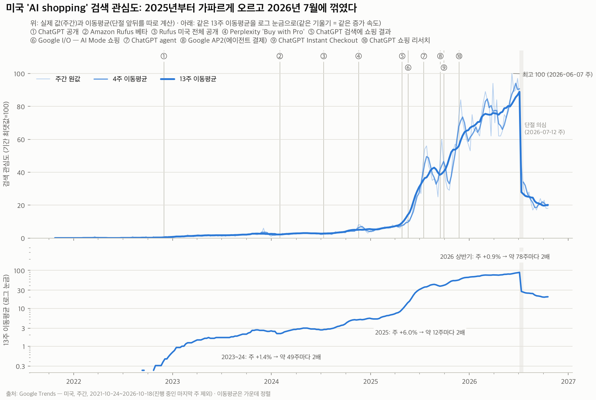

- **관찰**
  - 연평균 'AI shopping' 값은 2022년 0.13, 2023년 1.77, 2024년 3.33, 2025년 29.15, 2026년 1~7월 초 76.6이다. 2024년 → 2025년이 8.8배로 가장 크게 늘었다.
  - 13주 이동평균의 주간 증가율은 2023~24년 +1.4%(약 49주마다 2배), 2025년 +6.0%(약 12주마다 2배), 2026년 상반기 +0.9%(약 78주마다 2배)다.
  - 최고점은 2026-06-07 주(100)다. 2026-07-12 주부터 급락했고, 급락 후 14주 평균은 22.1이다.
- **해석(가설)**
  - 2025년은 '알게 되는' 단계의 폭발적 확산기로 보인다.
  - 2026년 상반기는 증가 속도가 2025년의 약 1/6로 줄었다. 새로 알아보는 사람이 줄어 포화에 가까워지는 단계일 수 있다.

### 그림 2. 분기 평균과 변동성 (Q1)

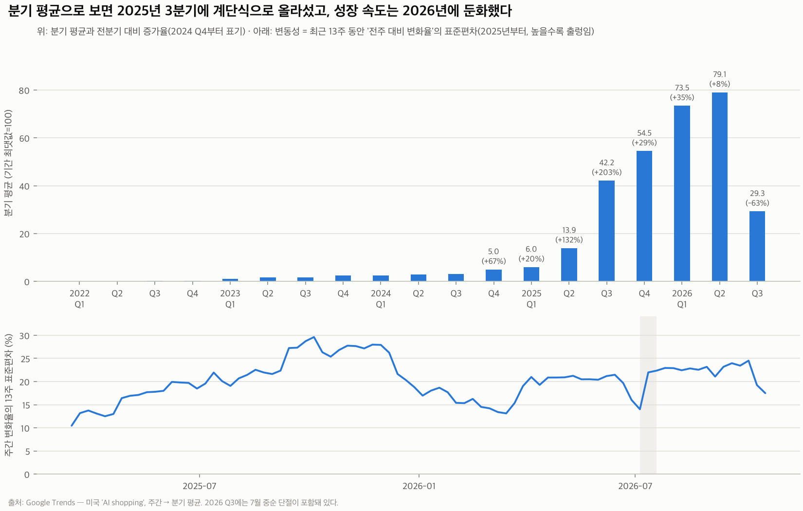

- **관찰**
  - 분기 평균은 2025 Q2 13.9(+132%), Q3 42.2(+203%), Q4 54.5(+29%), 2026 Q1 73.5(+35%), Q2 79.1(+8%), Q3 29.3(−63%, 단절 포함)이다. 전분기 대비 증가율은 2025 Q3에 가장 컸고 이후 계속 줄었다.
  - 변동성(주간 변화율의 13주 표준편차)의 평균은 2025년 하반기 24.2%, 2026년 상반기 18.0%다. 고점기에 오히려 덜 출렁였다.
- **해석(가설)**
  - 2025년 하반기에는 사건마다 크게 출렁이는 '뉴스 주도' 관심이었다.
  - 2026년 상반기에는 관심이 높은 수준에서 안정됐다.

### 그림 3. 급등 주와 외부 사건 (Q2)

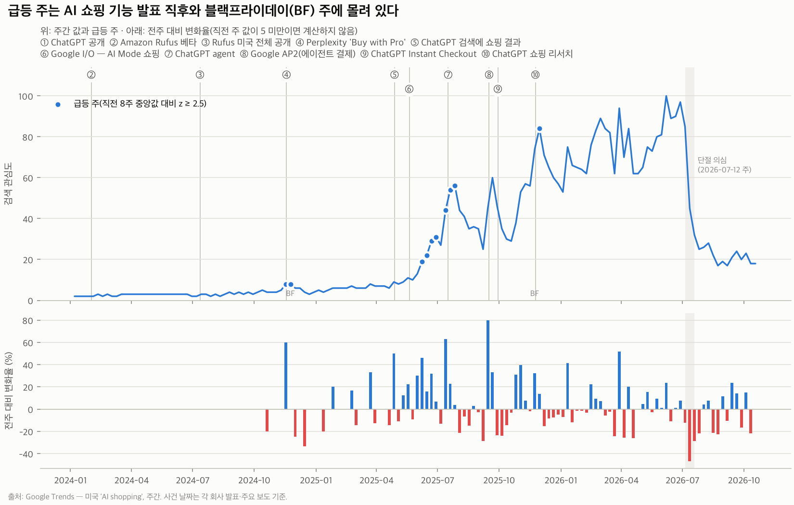

| 번호 | 날짜 | 사건 | 직전 4주 평균 | 이후 4주 평균 | 변화율 |
|---|---|---|---|---|---|
| ① | 2022-11-30 | [ChatGPT 공개](https://openai.com/index/chatgpt/) | 0.0 | 0.5 | - |
| ② | 2024-02-01 | Amazon Rufus 베타 | 1.8 | 2.2 | +29% |
| ③ | 2024-07-12 | [Rufus 미국 전체 공개](https://www.bloomberg.com/news/articles/2024-07-12/amazon-brings-rufus-ai-shopping-assistant-to-all-us-customers) | 2.8 | 2.5 | −9% |
| ④ | 2024-11-18 | [Perplexity 'Buy with Pro'](https://ppc.land/perplexity-launches-ai-powered-shopping-assistant-with-one-click-checkout-feature/) | 4.2 | 7.0 | +65% |
| ⑤ | 2025-04-28 | [ChatGPT 검색에 쇼핑 결과](https://searchengineland.com/openai-adds-shopping-features-to-chatgpt-search-454714) | 6.8 | 9.2 | +37% |
| ⑥ | 2025-05-20 | [Google I/O — AI Mode 쇼핑](https://9to5google.com/2025/05/20/google-ai-mode-shopping-with-buy-for-me/) | 8.0 | 13.2 | +66% |
| ⑦ | 2025-07-17 | [ChatGPT agent](https://techcrunch.com/2025/07/17/openai-launches-a-general-purpose-agent-in-chatgpt) | 27.2 | 49.5 | +82% |
| ⑧ | 2025-09-16 | [Google AP2(에이전트 결제 프로토콜)](https://decrypt.co/339752/google-reveals-ai-agent-payments-protocol-coinbase-ethereum-foundation) | 32.8 | 46.5 | +42% |
| ⑨ | 2025-09-29 | [ChatGPT Instant Checkout](https://openai.com/index/buy-it-in-chatgpt/) | 41.2 | 35.0 | −15% |
| ⑩ | 2025-11-24 | [ChatGPT 쇼핑 리서치](https://openai.com/index/chatgpt-shopping-research) | 51.0 | 73.5 | +44% |

| 블랙프라이데이 | 'AI shopping' 배수(BF 주 ÷ 직전 4주 평균) | 'online shopping' 배수 |
|---|---|---|
| 2023-11-24 | 1.20 | 1.29 |
| 2024-11-29 | 1.52 | 1.36 |
| 2025-11-28 | 1.45 | 1.68 |

- **관찰**
  - 급등 주는 모두 10주다.
    - 2024-11-17·24(④ 직후이자 블랙프라이데이 주)
    - 2025-06-08 ~ 06-29의 4주 연속(⑥ 3~6주 뒤)
    - 2025-07-13 ~ 07-27(⑦ 직후)
    - 2025-11-30(⑩과 블랙프라이데이가 겹친 주)
  - 사건 전후 4주 비교에서는 범용 AI(ChatGPT·Google·Perplexity) 발표 7건(④~⑩) 중 6건이 +37~+82%였다(예외 ⑨ −15%). 반면 Amazon 앱 안의 기능인 ③은 −9%였다.
  - 블랙프라이데이 주 배수는 'AI shopping'이 1.20~1.52, 'online shopping'이 1.29~1.68로 크기가 비슷하다.
- **해석(가설)**: 7절 인사이트 2에서 다룬다.

### 그림 4. 검색어 구성 변화 (Q3)

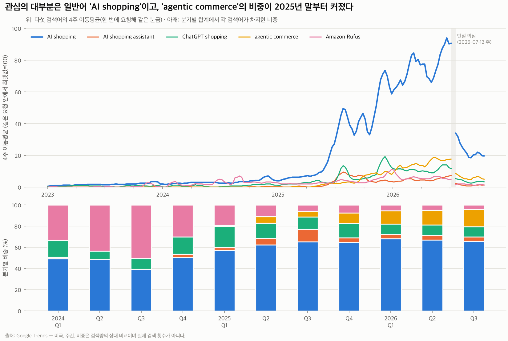

| 분기 | AI shopping | AI shopping assistant | ChatGPT shopping | agentic commerce | Amazon Rufus |
|---|---|---|---|---|---|
| 2024 Q3 | 39.4% | 0.0% | 10.1% | 0.0% | **50.5%** |
| 2025 Q1 | 57.4% | 2.2% | 20.6% | 0.7% | 19.1% |
| 2025 Q3 | 65.2% | 11.9% | 11.7% | 5.6% | 5.7% |
| 2026 Q1 | 68.1% | 4.1% | 9.9% | 12.4% | 5.6% |
| 2026 Q3 | 65.7% | 4.1% | 9.7% | **16.4%** | 4.1% |

- **관찰**
  - 일반어 'AI shopping'이 늘 가장 크다(39~68%).
  - 'agentic commerce' 비중은 2025 Q1 0.7%에서 2026 Q3 16.4%로 커졌다.
  - 'Amazon Rufus' 비중은 2024 Q3 50.5%에서 2026 Q3 4.1%로 줄었다. 그러나 연평균 값 자체는 2024년 2.8, 2025년 3.6, 2026년 1~7월 초 5.8로 오히려 늘었다.
  - 'ChatGPT shopping'은 ⑦·⑩ 직후(2025-07, 2025-11)에 뾰족하게 올랐다.

### 그림 5. 2026년 7월 급락 검증 — 대조군과 독립 측정 (Q4)

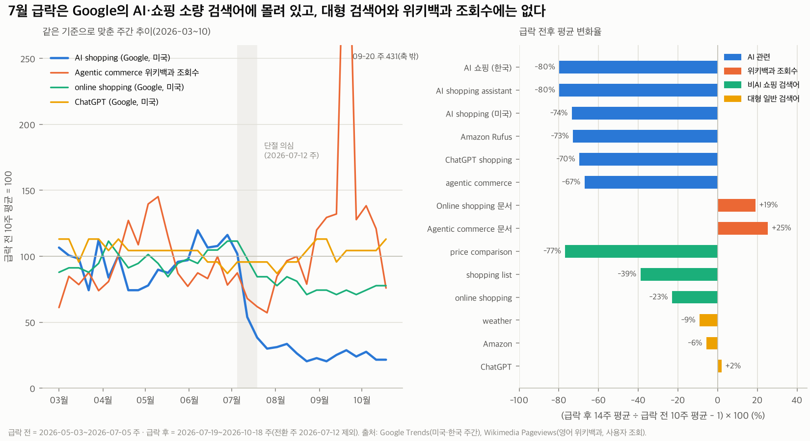

| 묶음 | 계열 | 급락 전 10주 평균 | 급락 후 14주 평균 | 변화율 | 1년 전 같은 구간 변화율 |
|---|---|---|---|---|---|
| AI 관련 | AI shopping(미국) | 83.5 | 22.1 | **−74%** | +128% |
| AI 관련 | AI shopping assistant · ChatGPT shopping · agentic commerce · Amazon Rufus | - | - | −67 ~ −80% | +18 ~ +237% |
| AI 관련 | AI 쇼핑(한국) | 82.1 | 16.6 | **−80%** | −71% |
| 비AI 쇼핑 소량 | price comparison · shopping list · online shopping | - | - | −77% · −39% · −23% | +169% · +39% · +5% |
| 대형 일반 | ChatGPT · Amazon · weather | - | - | +2% · −6% · −9% | +31% · +5% · −18% |
| 위키백과(독립 측정) | Agentic commerce 문서 · Online shopping 문서 | 304 · 1,973회/주 | 381 · 2,348회/주 | **+25% · +19%** | - · +21% |

- **관찰**
  - AI 관련 Google 검색어 6개가 모두 −67~−80% 떨어졌다. 미국과 한국이 같은 2026-07-12 주에 떨어졌다.
  - 검색량이 큰 일반 검색어는 −9~+2%에 그쳤다.
  - 비AI 쇼핑 소량 검색어도 −23~−77% 떨어졌다. 'online shopping'(+5% → −23%)과 'shopping list'(+39% → −39%)는 1년 전 같은 구간의 변화보다 훨씬 낮다.
  - 'price comparison'은 2024년 2.9에서 2026년 상반기 59.6으로 약 20배 뛰었다가 'AI shopping'과 함께 꺼졌다.
  - Google과 독립된 위키백과 조회수는 같은 기간 +19~+25% 늘었다. Agentic commerce 문서는 9월 말에 최고치(주 1,312회)를 찍었다.

### 그림 6. 일 단위로 본 급락 시점과 요일 패턴 (Q4 · 집계 단위 근거)

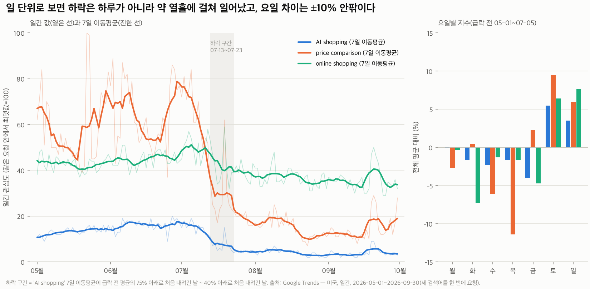

- **관찰**
  - 'AI shopping' 7일 이동평균은 2026-07-13에 급락 전 평균의 75% 아래로, 07-23에 40% 아래로 내려갔다. 하루 만에 뚝 떨어진 것이 아니라 **약 열흘에 걸쳐** 떨어졌다.
  - 'price comparison'도 같은 기간에 떨어졌다. 'online shopping'은 완만하게 내려갔다.
  - 요일 지수(급락 전 05-01~07-05, 전체 평균 = 100)
    - 'AI shopping': 월~금 96~100, 토 105.5, 일 103.5
    - 'online shopping': 토 106.4, 일 107.7
    - 'price comparison': 토 109.5, 일 106.0
    - 세 검색어 모두 주말이 3~10% 높고, 평일 차이는 대부분 ±5% 안이다(예외: 'price comparison' 목 −11%, 'online shopping' 화 −7%).

### 그림 7. 미국 vs 한국 (Q5)

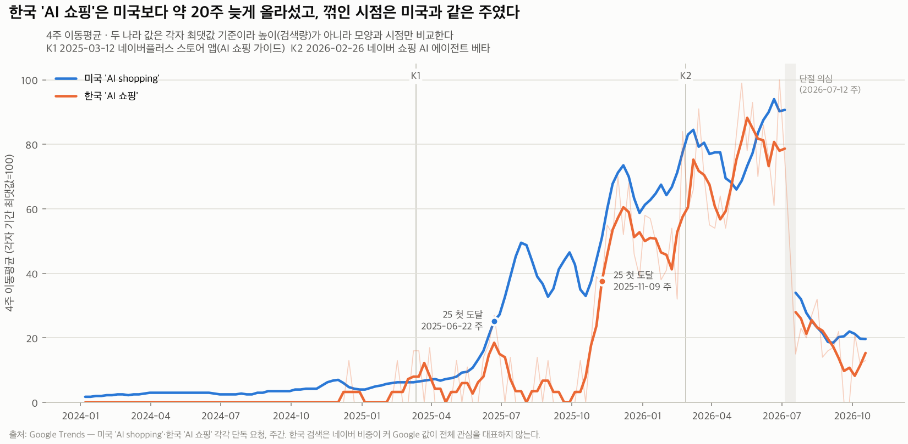

- **관찰**
  - 4주 이동평균이 처음 25에 도달한 주는 미국 2025-06-22, 한국 2025-11-09다. **20주 차이**다.
  - 한국은 K1(2025-03-12 [네이버플러스 스토어 앱·AI 쇼핑 가이드](https://view.asiae.co.kr/article/2025041016391179176)) 뒤 4주 평균이 3.2에서 12.2로 반짝 올랐다가 다시 0 근처로 돌아갔다.
  - K2(2026-02-26 [네이버 쇼핑 AI 에이전트 베타](https://www.sateconomy.co.kr/news/view/1065573568935144)) 뒤 4주 평균은 41.2에서 75.2로 +82% 올랐다.
  - 꺾인 주는 미국과 같은 2026-07-12 주다.
  - 한국 값은 261주 중 193주가 0이다. 2025년 가을 전까지는 검색량이 임계값 근처였다는 뜻이다.

### 6-2. 구간별 통계 (`outputs/phase_stats.csv`)

| 구간 | 기간 | 주 | 평균 | 표준편차 | 변동계수 | 최대 | 0인 주 |
|---|---|---|---|---|---|---|---|
| P0 ChatGPT 이전 | 2021-10 ~ 2022-11 | 58 | 0.07 | 0.26 | 3.71 | 1 | 93% |
| P1 생성형 AI 확산 | 2022-12 ~ 2024-12 | 109 | 2.48 | 1.39 | 0.56 | 8 | 2% |
| P2 쇼핑 기능 출시기 | 2025-01 ~ 2025-06 | 26 | 9.96 | 7.20 | 0.72 | 31 | 0% |
| P3 고점기 | 2025-07 ~ 2026-07-05 | 53 | 62.74 | 19.87 | 0.32 | 100 | 0% |
| P4 급락 이후 | 2026-07-12 ~ 2026-10-18 | 15 | 23.67 | 7.32 | 0.31 | 45 | 0% |

- 구간 경계는 외부 사건(ChatGPT 공개, 연도)과 그림 1에서 기울기가 바뀐 지점(2025-07, 2026-07)으로 정했다.

## 7. 인사이트

### 인사이트 1. 관심은 2025년에 폭발했고, 2026년 상반기에 둔화됐다

- **관찰(Fact)**
  - 연평균은 2024년 3.3, 2025년 29.2(×8.8), 2026년 1~7월 초 76.6(×2.6)이다.
  - 주간 증가율은 2023~24년 +1.4%, 2025년 +6.0%, 2026년 상반기 +0.9%다.
  - 전분기 대비 증가율은 2025 Q3 +203%로 정점을 찍은 뒤 2026 Q2 +8%까지 줄었다(그림 1·2).
- **원인(Why, 가설)**
  - 표에 정리한 사건 10건 중 6건(⑤~⑩)이 2025-04 ~ 2025-11에 몰려 있다. '처음 들어본 사람'의 검색이 한꺼번에 늘었다는 설명이 자연스럽다.
  - 2026년 상반기 둔화에는 두 가지 가능성이 있다.
    - (a) 인지가 퍼질 만큼 퍼져 새로 알아보는 검색이 줄었다(포화).
    - (b) 관심이 일반어 대신 서비스 이름이나 AI 앱 안으로 옮겨 갔다(이동).
  - 같은 기간 'agentic commerce'는 계속 올랐다(2026년 1~7월 초 평균 15.1). '관심 전체가 식었다'는 설명과는 맞지 않는다.
- **행동(Action)**
  - 성장 단계는 수준보다 **증가 속도(로그 기울기)**로 판단한다. 수준이 높아도 속도가 크게 떨어지면 확산기가 끝나 가는 신호다.
  - 포화인지 이동인지 가리려면 서비스 이름 검색어와 앱 사용 지표를 같은 기간으로 맞춰 다시 본다.

### 인사이트 2. 급등은 '범용 AI의 쇼핑 기능 발표 직후'와 '블랙프라이데이'에 온다

- **관찰(Fact)**
  - 급등 주 10주가 모두 사건 뒤 6주 안이나 블랙프라이데이 주에 있다.
  - ChatGPT·Google·Perplexity 발표 7건 중 6건에서 직후 4주 평균이 +37~+82% 올랐다(예외 ⑨). ⑦ ChatGPT agent가 +82%로 가장 컸다.
  - Amazon 앱 안 기능인 ③ Rufus 전체 공개는 −9%였다.
  - 블랙프라이데이 주에는 직전 4주의 1.20~1.52배가 됐다. 같은 주 'online shopping'은 1.29~1.68배였다.
- **원인(Why, 가설)**
  - 범용 AI의 기능 발표는 대중 보도로 이어지고, 사람들이 '그게 뭔지' 검색한다.
  - Rufus처럼 쇼핑 앱 안에서 바로 쓰는 기능은 검색할 필요가 없어 'AI shopping' 검색을 거의 움직이지 않는다.
  - 반례·주의
    - ⑨ Instant Checkout이 −15%인 것은 직전 4주에 ⑧ AP2 급등(2025-09-21 주 60)이 들어가 기준이 높았기 때문이다. 사건 창이 겹치면 효과가 과대·과소 추정된다.
    - ⑩ 쇼핑 리서치(11-24)는 블랙프라이데이(11-28)와 같은 주라 두 효과를 나눌 수 없다.
  - 블랙프라이데이 배수가 일반 온라인 쇼핑과 비슷하다. AI 쇼핑 관심도 쇼핑 시즌을 똑같이 탄다는 뜻이다.
- **행동(Action)**
  - 사건 효과는 다른 사건·시즌과 겹치지 않는 창에서만 해석한다.
  - 블랙프라이데이 효과(×1.2~1.5)를 먼저 빼고 사건 효과를 보는 후속 분석을 한다.
  - 서비스 출시를 알리려면 쇼핑 시즌 직전이나 대형 AI 발표 직후의 관심 상승을 노리는 것이 유리하다는 가설을 세울 수 있다.

### 인사이트 3. 관심의 중심이 '쇼핑 도우미'에서 'AI가 대신 사 주는 것(agentic)'으로 옮겨 가는 중

- **관찰(Fact)**
  - 'agentic commerce' 비중은 2025 Q1 0.7%에서 2026 Q3 16.4%로 커졌다.
  - 'Amazon Rufus' 비중은 2024 Q3 50.5%에서 2026 Q3 4.1%로 줄었다. 다만 Rufus의 절대값은 2024년 2.8에서 2026년 5.8로 늘었다(그림 4).
- **원인(Why, 가설)**
  - 2025년 9월 결제 표준(⑧ AP2, ⑨ ACP)이 나왔다. 'AI가 결제까지 대신한다'는 개념이 업계 용어로 퍼진 것으로 보인다.
  - Rufus 비중이 줄어든 것은 Rufus가 식어서가 아니다. 다른 검색어가 훨씬 빨리 커진 **상대 효과**다.
  - 반례: 'agentic commerce'는 소비자보다 업계·개발자가 쓰는 말일 수 있다. 소비자 관심이 옮겨 갔다고 단정하기는 어렵다.
- **행동(Action)**
  - 비중(상대값)과 절대값을 항상 함께 본다.
  - 소비자 관심과 업계 관심을 나눠 보려면 소비자 쪽 검색어(예: "AI buy for me")를 추가로 수집해 비교한다.

### 인사이트 4. 2026년 7월 급락(−74%)은 '관심 감소'보다 '측정 변화'일 가능성이 크다

- **관찰(Fact)**
  - AI 관련 Google 검색어 6개가 미국·한국 같은 주에 −67~−80% 떨어졌다.
  - 대형 일반 검색어는 −9~+2%로 거의 그대로였다.
  - 비AI 쇼핑 소량 검색어도 −23~−77% 떨어졌다. 이는 1년 전 같은 구간의 변화(+5~+169%)와 반대 방향이다.
  - 독립 측정인 위키백과 조회수는 +19~+25% 늘었다.
  - 일간으로 보면 07-13 ~ 07-23의 약 열흘에 걸쳐 떨어졌다(그림 5·6).
- **원인(Why, 가설 3개와 근거·반례)**
  - **H1. Google 쪽 집계 변화**(자동화된 검색의 필터 강화, 표본 방식 변경 등)
    - 근거
      - 두 나라·여러 검색어가 같은 주에 떨어졌다.
      - 검색량이 작은 검색어일수록 크게 떨어지고 대형 검색어는 그대로다.
      - 독립 측정(위키백과)은 오히려 늘었다.
      - 'price comparison'이 2025~26년에 'AI shopping'과 함께 약 20배 뛰었다가 함께 꺼졌다. 같은 성분(예: 자동화된 질의)이 섞여 있었을 수 있다.
    - 반례·미확인: Google 공식 공지는 찾지 못했다. 2026년 7월의 Trends 변경으로 확인된 것은 '기간 비교' 화면 기능뿐이다.
  - **H2. 검색 행동의 이동**(AI 쇼핑 질문이 검색창 대신 AI 모드·챗봇 안으로)
    - 근거: AI 관련 검색어가 가장 크게 떨어졌다.
    - 반례: 행동 이동이라면 점진적이어야 하는데, 두 나라에서 열흘 만에 동시에 일어났다.
  - **H3. 실제 관심 감소**
    - 반례: 위키백과 'Agentic commerce' 조회가 +25%였고 9월 말에 최고치를 찍었다.
  - **판단**: 세 가설 중 H1이 관찰과 가장 잘 맞는다. 다만 원인은 확정하지 못했다.
- **행동(Action)**
  - 2026-07-12 주 앞뒤의 값은 직접 비교하지 않는다. 이 리포트의 추세·분해·예측 검증은 그 전 구간만 쓴다.
  - 원인을 확인하려면 다른 측정(네이버 데이터랩, Bing, 앱 사용 지표)으로 교차 검증한다.
  - Google Trends를 장기 비교에 쓸 때는 **대조 검색어를 함께 받아 두는 것**을 기본 절차로 한다. 이번 판단이 가능했던 것도 대조군 덕분이다.
  - 2025~26년 상승분 일부에도 같은 성분이 섞여 있었을 수 있다. 인사이트 1의 성장 폭은 상한값으로 읽는다.

### 인사이트 5. 한국은 미국을 약 20주 늦게 따라왔고, 국내 플랫폼 출시에 반응했다

- **관찰(Fact)**
  - 4주 이동평균이 25에 처음 도달한 주는 미국 2025-06-22, 한국 2025-11-09다(20주 차이).
  - 한국은 K1 뒤 반짝(+277%) 올랐다가 원래대로 돌아갔고, K2 뒤에는 +82% 올랐다.
  - 한국은 261주 중 193주가 0이다(그림 7).
- **원인(Why, 가설)**
  - 한국 이용자에게 실감 나는 계기는 해외 서비스 발표보다 국내 플랫폼(네이버)의 AI 쇼핑 기능이었을 수 있다.
  - 반례·한계
    - 한국은 검색의 상당 부분이 네이버에서 일어난다. Google 값은 소수 이용자의 신호라 0이 많고 들쭉날쭉하다.
    - 20주라는 시차도 이 측정 한계 안에서 나온 값이다.
- **행동(Action)**
  - 같은 분석을 네이버 데이터랩(검색어 트렌드·쇼핑인사이트)으로 반복해 대표성을 확보한다.
  - '미국 흐름 = 한국의 선행 지표'라는 가설은 다른 기능(대리 결제 등)에서도 시차가 반복되는지 확인한 뒤에 쓴다.

## 8. 보너스 과제

### 8-1. 시계열 분해(A) — STL

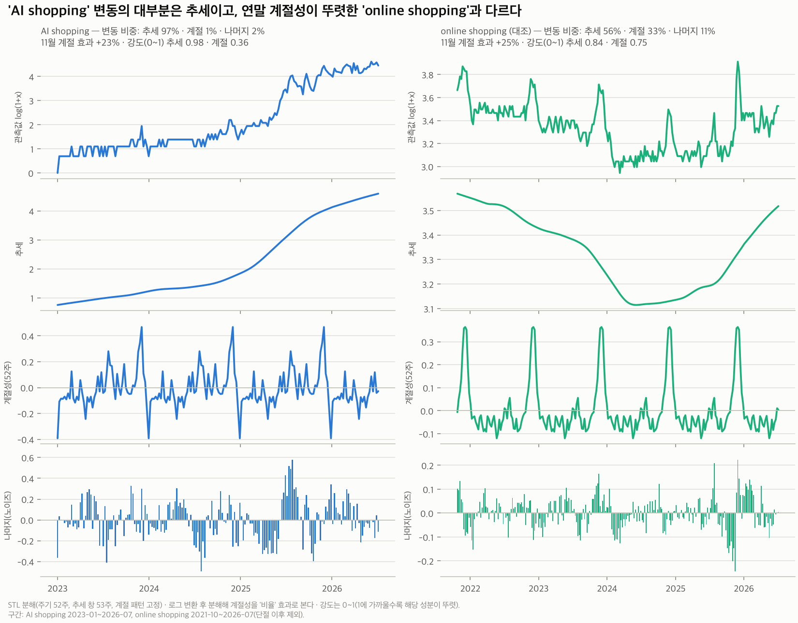

- **방법**
  - STL 분해(주기 52주)를 log(1+x)에 적용했다. 로그를 쓴 것은 계절 효과를 '%'로 읽기 위해서다.
  - 주기가 3~4번뿐이라 해마다 달라지는 계절성은 추정할 수 없다. 그래서 계절 패턴을 고정하고(`seasonal=999, seasonal_deg=0`), 추세 창은 허용 최소인 53주로 둬 빠른 성장을 따라가게 했다.
  - 기간: 'AI shopping' 2023-01 ~ 2026-07, 대조 'online shopping' 2021-10 ~ 2026-07(단절 이후 제외).
- **관찰**

| 계열 | 추세 비중 | 계절 비중 | 나머지(노이즈) | 11월 계절 효과 | 12월 | 7월 |
|---|---|---|---|---|---|---|
| AI shopping | 97% | 1% | 2% | +23% | +2% | +12% |
| online shopping | 56% | 33% | 11% | +25% | +25% | +1% |

- **해석**
  - **트렌드**(장기 방향), **계절성**(해마다 같은 시기에 반복되는 오르내림), **노이즈**(둘로 설명되지 않는 나머지)로 나눠 보면 'AI shopping' 변동의 97%가 추세다. 아직 '성장 단계'라 계절성이 추세에 묻힌다.
  - 그래도 11월 효과(+23%)는 일반 온라인 쇼핑(+25%)과 비슷하게 잡힌다. 쇼핑 시즌 효과가 있다는 인사이트 2와 맞는다.
  - 7월 +12%는 해마다 반복되는 계절성이라기보다 2025년 7월 한 번의 급등(⑦)이 계절성으로 흡수된 것으로 보인다. 주기가 3.5번뿐이면 단발 사건과 계절을 구분할 수 없다는 한계를 보여 준다.

### 8-2. 베이스라인 예측(B)

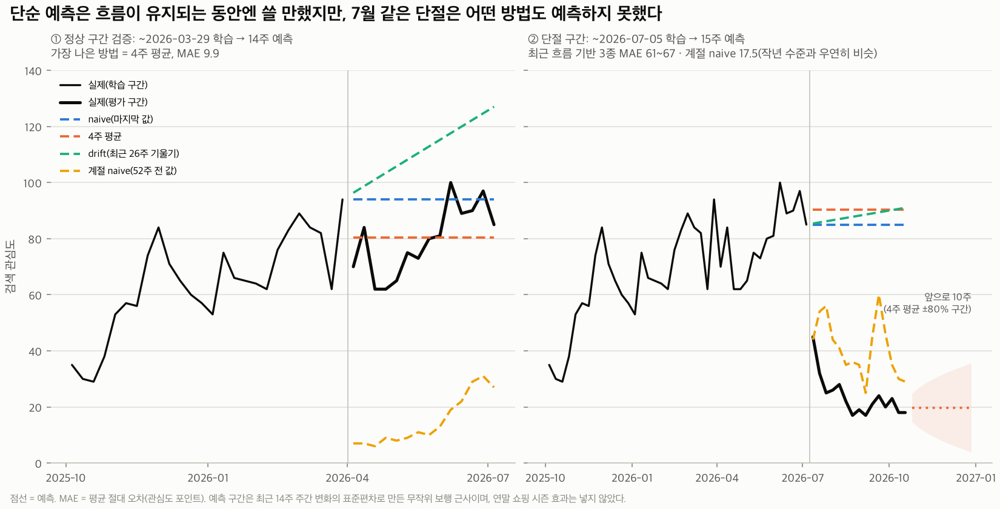

- **가정**
  - naive: 마지막 값이 그대로 유지된다.
  - 4주 평균: 최근 수준이 유지된다.
  - drift: 최근 26주 기울기가 계속된다.
  - 계절 naive: 작년 이맘때가 반복된다.

| 실험 | 학습 → 예측 | naive | 4주 평균 | drift | 계절 naive |
|---|---|---|---|---|---|
| ① 정상 구간 검증 | ~2026-03-29 → 14주 | MAE 15.8 (MAPE 22%) | **MAE 9.9 (13%)** | 32.2 (42%) | 64.6 (82%) |
| ② 단절 구간 | ~2026-07-05 → 15주 | 61.3 (284%) | 66.6 (308%) | 64.5 (300%) | 17.5 (79%) |

- **관찰**
  - 흐름이 유지된 구간(①)에서는 '최근 4주 평균'이 가장 잘 맞았다(평균 오차 9.9포인트, 13%).
  - 성장 중인 계열에서 계절 naive는 작년의 낮은 수준을 그대로 가져와 가장 크게 틀렸다(64.6).
  - 단절 구간(②)에서는 최근 흐름에 기댄 세 방법이 모두 300% 안팎으로 틀렸다.
  - ②에서 계절 naive가 17.5로 '가장 잘 맞은' 것은 작년 7~10월 수준(25~56)이 단절 후 수준(약 22)과 **우연히 비슷했기 때문**이다. 맞힌 이유가 틀린 예측이다.
- **앞으로 10주(2026-10-25 ~ 12-27)**
  - 4주 평균 기준 19.8이다. 80% 구간은 첫 주 14.7~24.8에서 10주째 3.9~35.6으로 넓어진다.
  - 구간은 최근 14주 주간 변화의 표준편차로 만든 무작위 보행 근사다.
  - 블랙프라이데이 효과는 넣지 않았다. 2023~25년 배수(×1.2~1.5)를 그대로 적용하면 11-22 주 전후에 24~30 정도가 될 수 있다.
- **한계**
  - 베이스라인은 '과거 패턴이 유지된다'는 가정 위에 있다. 측정 방식이 바뀌는 단절은 원리상 예측할 수 없다.
  - 정확도보다 "어떤 가정이 깨지면 무엇이 틀리는가"를 확인하는 도구로 썼다.

### 8-3. 대시보드

- **제출 방식**: (3) 대시보드 스크린샷 세트 + 필터·기간 변경 시나리오 설명.
- **실행**: `python build_dashboard.py` 후 `dashboard/index.html`을 브라우저로 연다. 파일 하나로 동작하며 서버·인터넷·외부 라이브러리가 필요 없다.
- **기능**
  - 묶음 5종, 보기 4종(원값 · 지수 · 직전 대비 · 전년 대비), 집계 3종(주 · 월 · 분기), 이동평균, 기간(날짜·빠른 기간)
  - 계열 켜기/끄기, 사건·단절 구간 표시, 마우스·방향키 툴팁, 선택 기간 요약 표, 전체 값 표
  - 화면 상태가 주소에 저장돼 같은 화면을 다시 열 수 있다.

| # | 시나리오(조작) | 화면 | 확인되는 것 |
|---|---|---|---|
| 1 | 기본: 미국 5종 · 원값 · 주 · 이동평균 4 · 전체 기간 · 사건 표시, 2026-06-07 주에 툴팁 | 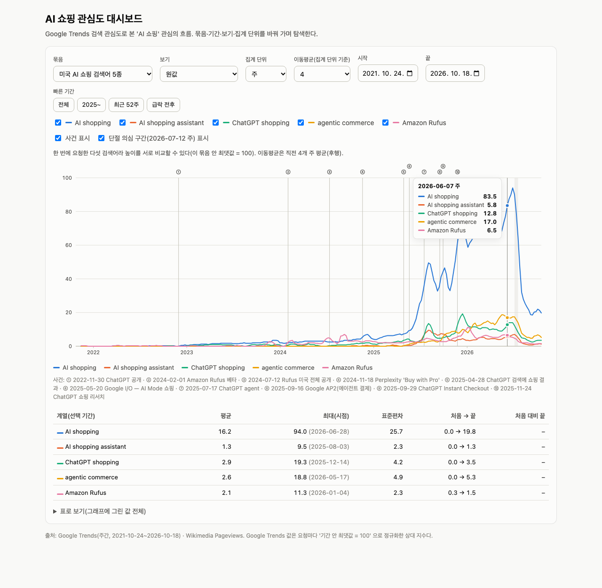 | 2025년 급증과 2026-07 급락, 최고점 주의 검색어별 값 |
| 2 | 보기를 '직전 대비 변화율'로, 기간을 '2025~'로, 'AI shopping'만 켬, 2025-07-13 주 툴팁 | 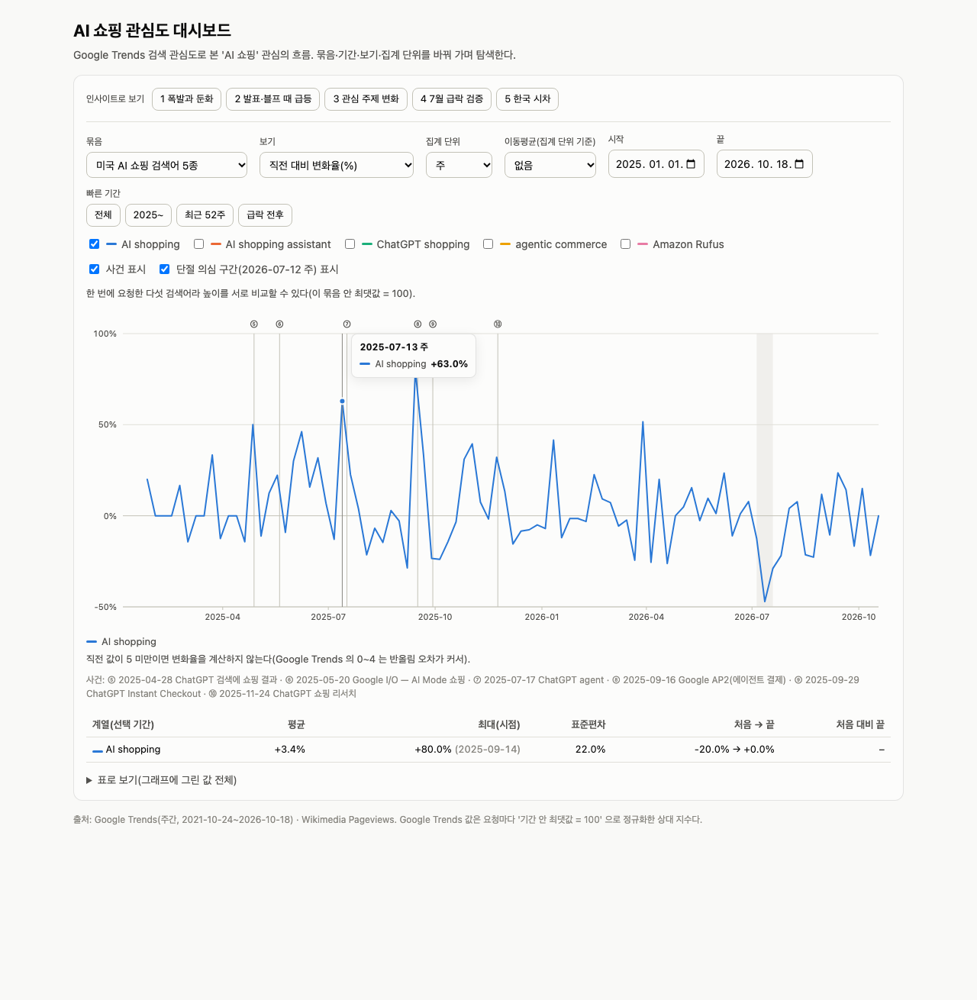 | ⑦ ChatGPT agent 직후 +63%, ⑧ 직후 +80% 같은 급등 주 |
| 3 | 묶음을 '미국 vs 한국'으로, 기간 2024-07~ | 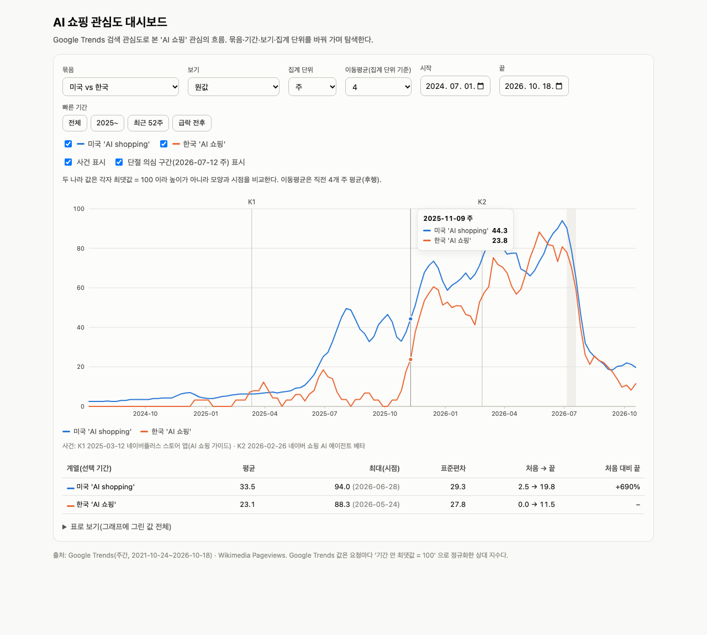 | 한국이 미국을 약 20주 늦게 따라온 모양, K1·K2 시점 |
| 4 | 묶음을 '대조: 쇼핑 소량 검색어'로, 보기를 '지수(기간 첫 4개 평균 = 100)'로, '급락 전후' 기간 | 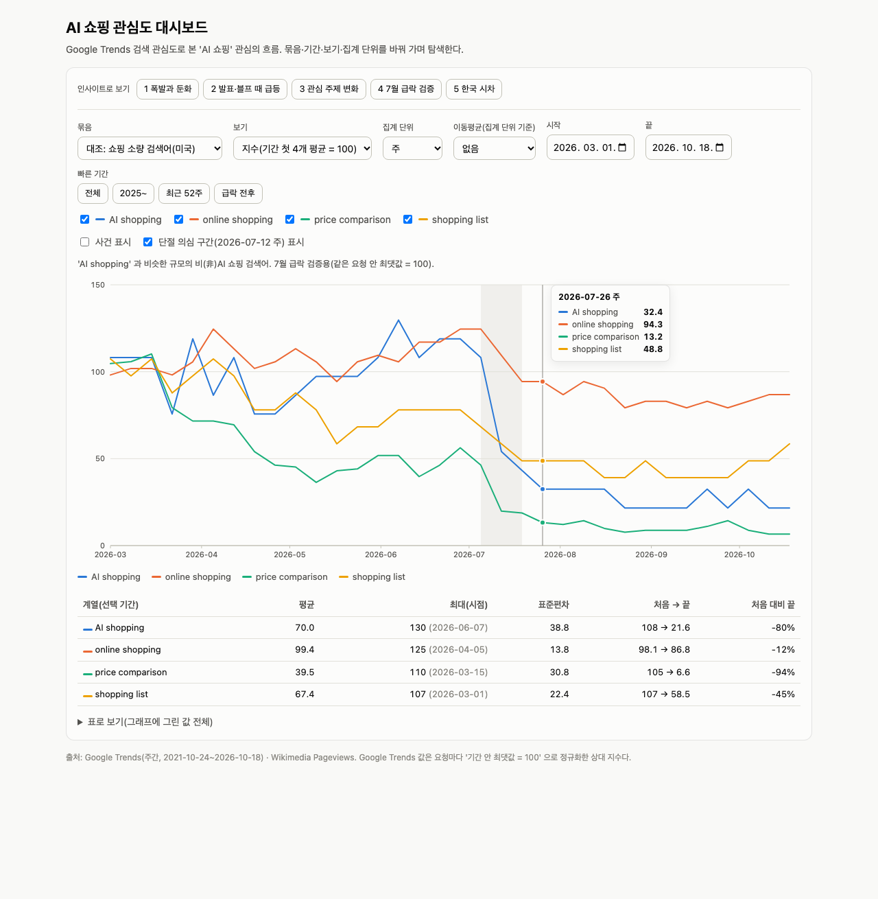 | 2026-07 이후 'AI shopping'·'price comparison'은 급락, 'online shopping'은 소폭 하락 |
| 5 | 미국 5종에서 'AI shopping'·'Amazon Rufus'만 켜고, 집계를 '분기 평균', 보기를 '전년 같은 시기 대비'로 | 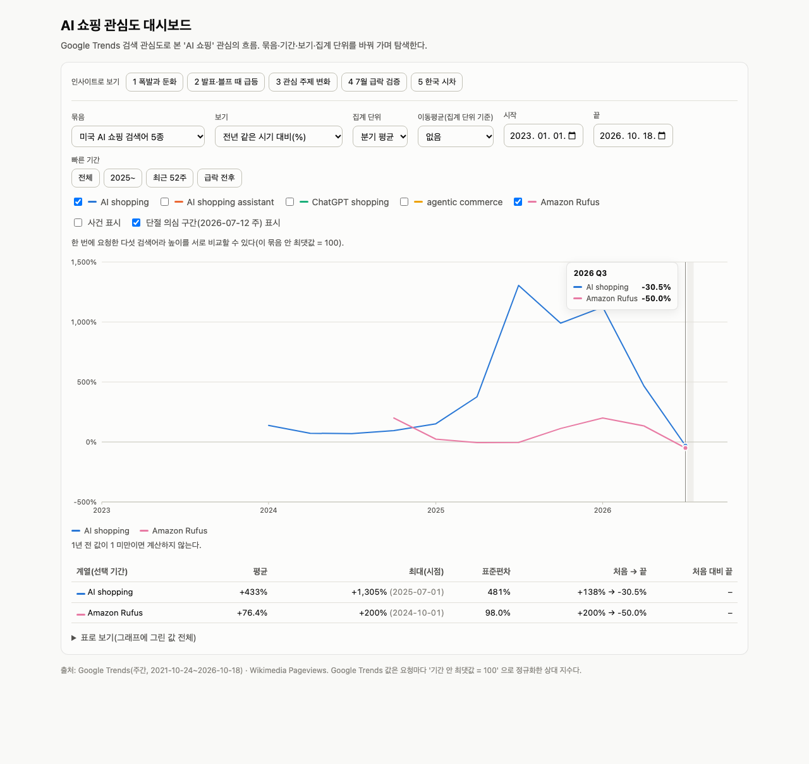 | 2025 Q3 전년 대비 +1,305% 정점, 2026 Q3 −30.5% |
| 6 | 묶음을 '위키백과 조회수'로, 기간 2025-12~ | 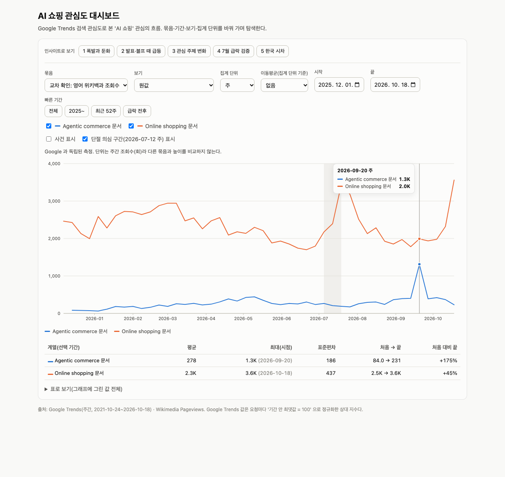 | 7월 단절 구간에 위키백과는 떨어지지 않음, 9월 말 Agentic commerce 최고치 |
| 7 | 휴대폰 폭(390px)에서 월 평균 보기 | 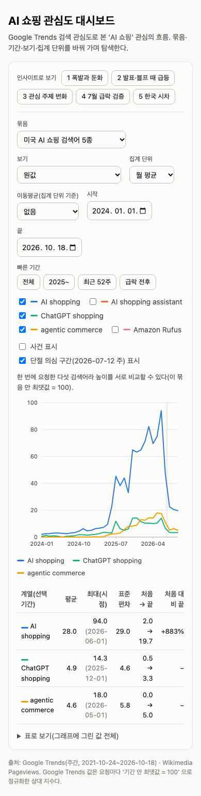 | 필터가 줄바꿈되고 그래프·표가 화면 폭에 맞춰짐 |

## 9. 결론 및 한계점

### 결론

- **Q1(언제·얼마나)**: 2023~24년에 천천히 늘다가 2025년에 약 12주마다 2배씩 폭발했고, 2026년 상반기에는 약 78주마다 2배 속도로 둔화됐다. 연평균은 2024년 3.3에서 2026년 1~7월 초 76.6까지 올랐다.
- **Q2(급등 계기)**: 범용 AI의 쇼핑 기능 발표 직후 4주에 +37~+82% 올랐고, 블랙프라이데이 주에는 ×1.2~1.5였다. 앱 안 기능 발표는 검색을 거의 움직이지 않았다.
- **Q3(관심의 내용)**: 일반어가 중심인 가운데 'agentic commerce'(대신 사 주는 AI) 비중이 0.7%에서 16.4%로 커졌다.
- **Q4(7월 급락)**: AI·소량 검색어에만 있었고, 대형 검색어와 위키백과 조회수에는 없었다. 관심 감소보다 측정 변화일 가능성이 크지만 원인은 확정하지 못했다.
- **Q5(한국)**: 미국보다 약 20주 늦게 올라섰고, 국내 플랫폼 출시(K1·K2)에 반응했다.

### 한계점

1. **검색 관심 ≠ 실제 사용·구매**: 검색 없이 앱 안에서 바로 쓰는 관심은 잡히지 않는다.
2. **상대 지수·표본 기반**: 요청마다 기준(최댓값 = 100)이 달라 요청 사이의 높이는 비교할 수 없다. 다시 받으면 값이 조금 달라진다(같은 검색어의 두 요청 상관 0.997).
3. **2026-07 단절의 원인 미확정**: 그 이후 수준을 이전과 비교할 수 없다. 2025~26년 상승분에도 같은 성분이 섞여 있었을 수 있다.
4. **사건 연결은 시점 일치일 뿐 인과가 아니다**: 사건 창이 겹치거나 시즌과 겹치면 효과를 분리할 수 없다.
5. **검색어 선택 편향**: 영어 'AI shopping' 계열 5개가 미국의 AI 쇼핑 관심 전체를 대표한다고 볼 수 없다.
6. **한국 대표성 부족**: 한국 Google 검색량이 작아 0이 많다(193/261주). 네이버 데이터로 보완이 필요하다.
7. **분해·예측의 짧은 이력**: 주기가 3.5번뿐이라 계절성 추정이 불안정하다. 외부 변수(경기·광고비·보도량)는 반영하지 않았다.

## 10. AI 사용 로그

- 사용한 AI: Claude Code(Anthropic, Claude Opus 5.5). 터미널에서 코드 작성·실행, 웹 검색으로 사실 확인.
- 주제와 범위(AI 쇼핑 관심도, 보너스 2종 수행)는 작성자가 정했다. 수집·분석·시각화·초안 작성에 AI를 썼고, 아래 방법으로 결과를 검증했다.

| 작업 | 사용 이유 | 검증 방법 |
|---|---|---|
| 데이터 출처 탐색(키 없이 받을 수 있는 출처를 실제로 호출해 비교) | 대안 탐색 · 시간 절감 | 후보별 응답 행 수·기간·0 비율을 직접 확인. GDELT는 429(요청 제한)로 제외. 5년 넘는 기간이 월간(70개)으로만 나와 100개 미만이 되는 문제를 발견하고 기간을 5년으로 맞춰 주간 261개 확보 |
| 수집 코드(`collect.py`) 작성·오류 수정 | 시간 절감 | pytrends 재시도 옵션이 최신 urllib3와 충돌하는 오류를 확인하고 자체 재시도로 교체. 저장한 CSV의 행 수·`isPartial`·날짜 연속성 확인. 같은 'AI shopping'을 다른 요청에서 받아 상관 0.997 확인 |
| 정제·분석 코드(`analysis.py`) 작성 | 시간 절감 | 표본 재계산: 2025 Q3 평균(42.15), ⑦ 사건 전후 4주 평균(27.25 → 49.5), 2024 블랙프라이데이 배수(8 ÷ 5.25 = 1.52), 급락 전후 평균(83.5 → 22.1)을 원자료에서 따로 계산해 일치 확인 |
| 시각화 | 대안 비교(선형 vs 로그 눈금, 원값 vs 지수화, 겹침 배치) | 그림을 렌더링해 직접 보고 고침(사건 번호 겹침, 범례 위치, 요일 막대 기준선, 잘린 범례 줄). 색은 색각 이상 구분 검증 스크립트로 확인 |
| 외부 사건 날짜 | AI 기억에 기대지 않기 위해 | 웹 검색으로 회사 발표·주요 보도의 날짜를 확인하고 링크를 표에 남김. 보도마다 날짜가 다른 경우(Perplexity 11-11 vs 11-18)는 회사 공식 글 기준 |
| 해석(가설 후보·반례 찾기) | 대안 탐색 | 가설마다 데이터로 확인할 수 있는 근거·반례를 대조군·위키백과·일간 데이터로 확인. 확인하지 못한 것은 '가설'·'미확인'으로 표기 |
| 문장 다듬기 | 시간 절감 | 수치는 `outputs/key_numbers.json`과 표 CSV에서 옮기고 대조 |

**AI 결과를 검증하다 고친 사례**

- 급락 그림의 첫 제목은 "AI 관련 검색어에만 급락"이었다. 대조군 표에서 비AI 소량 검색어도 −23~−77% 떨어진 것을 확인하고 "AI·쇼핑 소량 검색어에 몰려 있다"로 고쳤다.
- 예측 그림의 단절 구간에 '가장 나은 방법 = 계절 naive'로 표시돼 있었다. 작년 수준과 우연히 비슷해서 생긴 결과임을 확인하고 그렇게 명시했다.
- 2026년 상반기를 처음에는 '정체(주 +0.1%)'로 적었다. 대시보드 캡처를 점검하다가, 가운데 정렬 13주 이동평균이 6월 말 근처에서 7월 단절 이후의 낮은 값을 섞어 생긴 착시임을 확인했다. 이동평균을 단절 앞뒤로 나눠 계산하도록 고쳐 '둔화(주 +0.9%)'로 바로잡았다(원값 직선 맞춤도 +1.2%로 같은 결론).
- STL 기본 설정(robust)에서는 추세가 직선 두 토막으로 나오고, 계절성이 단발 급등을 흡수했다. 설정을 비교한 뒤 '계절 패턴 고정 + 추세 창 53주'로 바꾸고 이유를 적었다.
- 한국이 '10 첫 도달'에서는 미국보다 9주 **앞서는** 결과가 나왔다. 확인해 보니 K1 직후의 일시적 반짝 때문이었다. 그래서 지속 상승 기준(25)을 쓰고 반짝은 따로 서술했다.
- 변동성 지표로 처음에는 변동계수(표준편차 ÷ 평균)를 썼다. 그런데 성장기에는 추세 자체가 변동으로 잡혔다. 그래서 주간 로그 변화율의 표준편차로 바꿨다.
