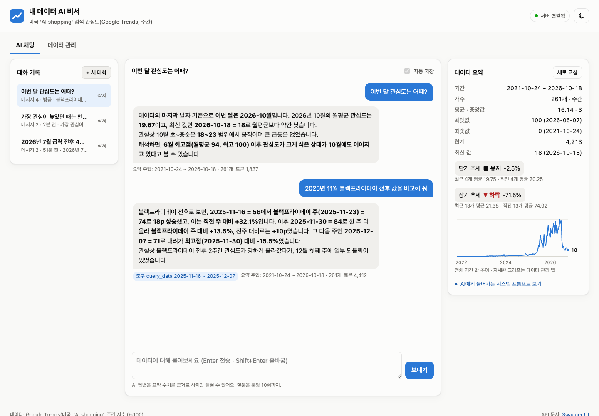
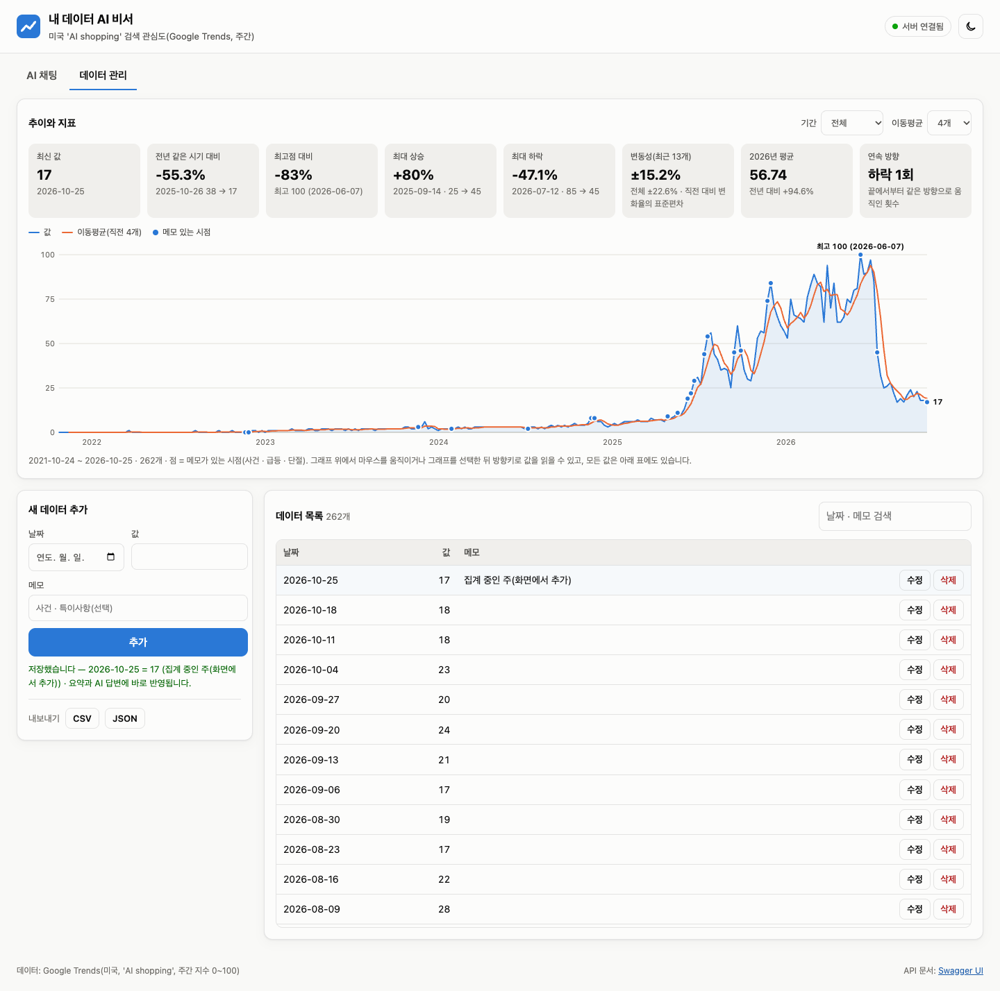
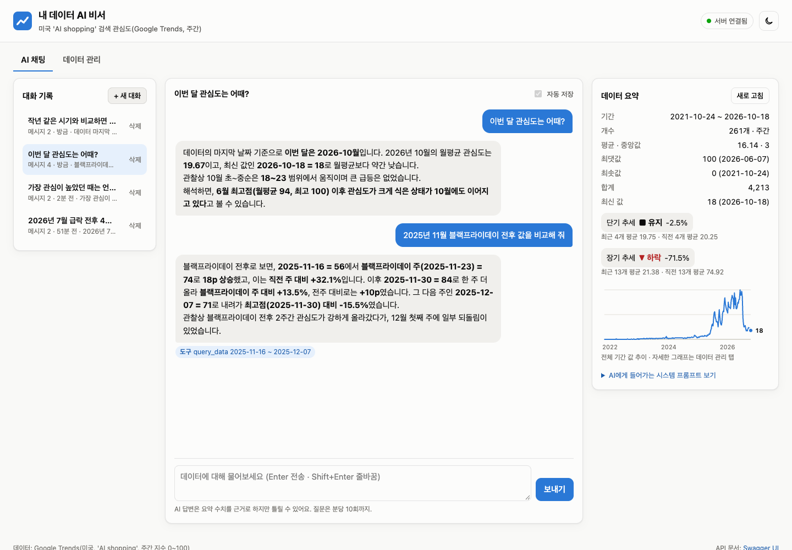
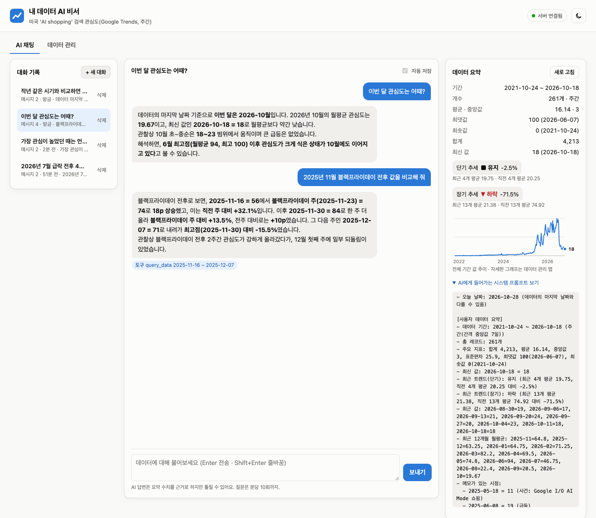
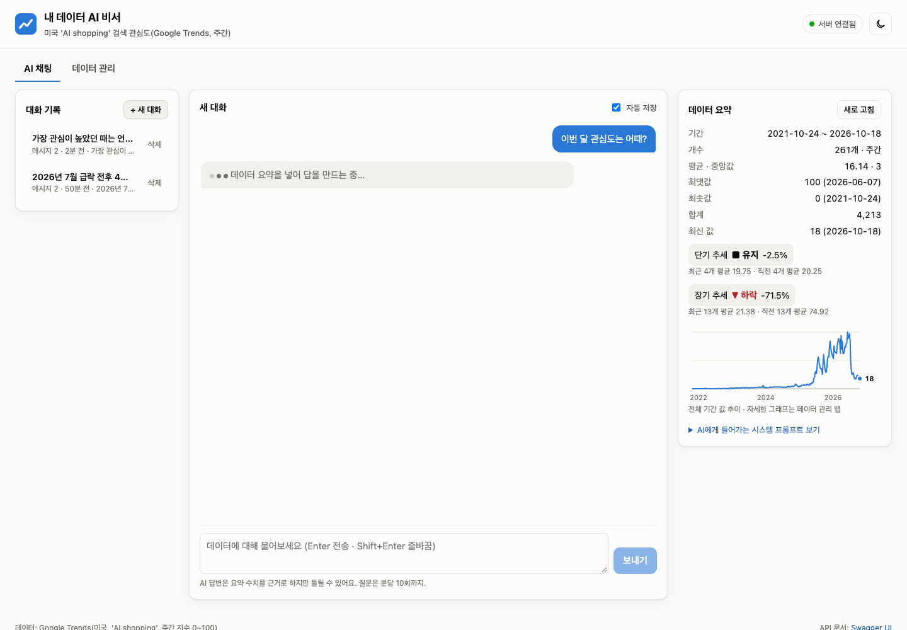
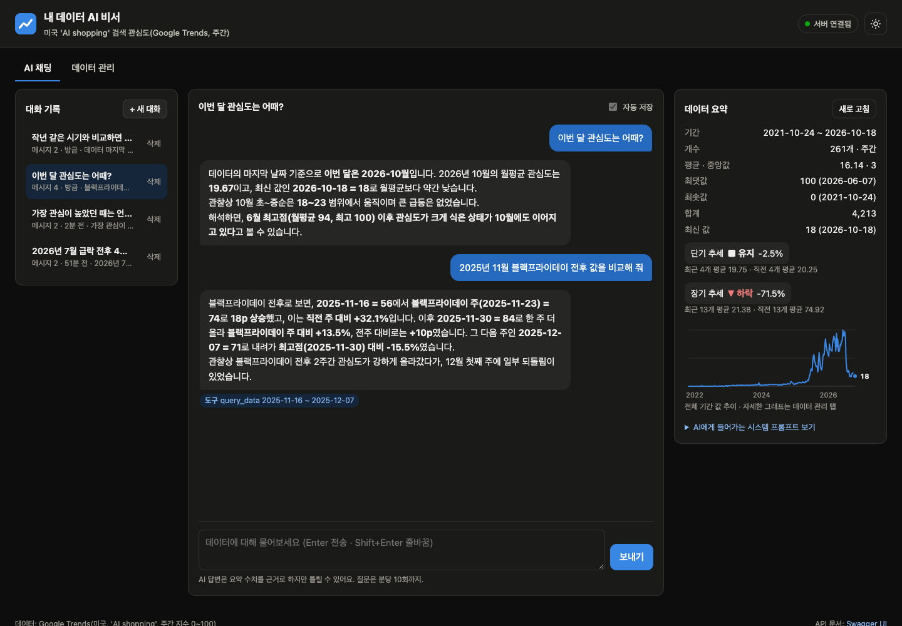

# 내 데이터를 아는 AI 비서

일반 챗봇은 내 데이터를 모른다. 이 서비스는 **저장된 시계열 데이터를 분석한 요약을 매 질문마다 GPT 의 시스템 프롬프트에 넣어**, "이번 달은 어때?", "가장 높았던 때는?" 같은 질문에 내 데이터의 날짜와 수치로 답하게 한다. 데이터를 추가 · 수정 · 삭제하면 다음 질문부터 바뀐 요약이 반영되고, 대화는 자동으로 저장돼 나중에 다시 불러올 수 있다.

- 데이터: 미국 Google Trends **'AI shopping' 검색 관심도, 주간 261개**(2021-10-24 ~ 2026-10-18) — 미션1 「시계열 데이터 분석 인사이트 리포트」의 주 데이터
- Codyssey AI_final 미션2 산출물 · 필수 4기능 + 보너스 2종(Function Calling + MCP · 인사이트/UX)

## 배포 URL

| 구분 | 주소 |
| --- | --- |
| 프론트엔드(Vercel) | <https://codyssey-mydata-ai.vercel.app> |
| 백엔드 API(Render) | <https://codyssey-mydata-api.onrender.com> |
| Swagger UI | <https://codyssey-mydata-api.onrender.com/docs> |

> 백엔드는 Render 무료 서버라 15분 동안 요청이 없으면 잠든다. 첫 접속은 30~60초 걸릴 수 있고, 화면 위쪽에 "서버가 잠에서 깨는 중" 안내와 경과 시간이 뜬 뒤 자동으로 이어진다.

## 화면

| 데이터 요약이 보이는 채팅 | 데이터 관리(추가 결과) | 대화 기록 불러오기 |
| --- | --- | --- |
|  |  |  |

- 01 — 질문과 답변, 답변 아래 '도구 · 요약 주입 · 토큰' 표시, 오른쪽에 같은 요약(기간 · 개수 · 지표 · 단기/장기 추세 · 미니 그래프)
- 02 — 날짜 · 값 · 메모 입력 → "저장했습니다 — 2026-10-25 = 17" 결과 문구, 새 행 강조, 지표 · 그래프 갱신
- 03 — 왼쪽 목록에서 지난 대화를 눌러 전체 메시지 재표시(주소 `?c=<대화 ID>`)


| 컨텍스트 주입 확인 | 로딩 표시 | 다크 모드 · 모바일 |
| --- | --- | --- |
|  |  |  |

- 08 — 요약 패널의 'AI에게 들어가는 시스템 프롬프트 보기' 를 펼친 화면. 패널의 수치와 프롬프트 안의 수치가 같다
- 그 밖에 [`06_mobile.png`](docs/screenshots/06_mobile.png)(390px) · [`07_swagger.png`](docs/screenshots/07_swagger.png)(배포 API 의 Swagger UI, 작업 14개)

## 동작 흐름

```text
[브라우저 — Vercel 정적 페이지(HTML/CSS/JS)]
   │  질문 입력 → POST /api/chat {message, conversation_id?}
   ▼
[FastAPI — Render]
   ① 데이터 요약   data_service.summary()  ← Firestore data 컬렉션(60초 캐시)
   ② 컨텍스트 주입  요약 → 시스템 프롬프트 문장(기간 · 개수 · 지표 · 추세 · 최근 값 · 월평균 · 메모 시점 + 답변 규칙)
   ③ GPT 호출      gpt-5.4-mini (Chat Completions, 응답 토큰 상한 1,000)
        └ 필요하면 도구 호출(보너스) → 서버가 실행 → 결과를 붙여 다시 호출(최대 3회)
   ④ 자동 저장     질문 · 답 · 호출한 도구 → Firestore conversations 컬렉션
   ▼
[브라우저]  답변 + 호출한 도구 · 주입된 요약 · 토큰 표시, 대화 목록 갱신
```

## 기술 스택

| 층 | 기술 | 비고 |
| --- | --- | --- |
| 백엔드 | Python 3.13 · FastAPI 0.162 · Uvicorn · Pydantic 2 | 라우터 / 서비스 / 저장소 분리, Swagger UI 자동 생성 |
| DB | Firebase Firestore(서울 리전) · firebase-admin 7.7 | 컬렉션 `data` · `conversations` |
| AI | OpenAI `gpt-5.4-mini` · openai 3.40 | Chat Completions + Function Calling |
| 프론트엔드 | HTML · CSS · JavaScript(ES 모듈) | 프레임워크 · 외부 라이브러리 없음, 그래프도 직접 그린 SVG |
| 배포 | Render(백엔드 무료 웹 서비스) · Vercel(정적 사이트) | `render.yaml` Blueprint · `vercel.json` 빌드 |
| 보너스 | MCP Python SDK 2.3(`MCPServer`, stdio) | 같은 도구를 외부 MCP 클라이언트에 공개 |
| 테스트 | pytest · FastAPI TestClient · Firestore 에뮬레이터 | 가짜 GPT · 메모리 저장소로 네트워크 없이 실행 |

## 폴더 구조

```text
mission2/
├── README.md · 과제 요약.md · 실행 로그.md · 평가 지침.md
├── render.yaml                    Render Blueprint(백엔드 배포 설정)
├── docs/screenshots/              제출 스크린샷
├── backend/
│   ├── main.py                    앱 생성 · CORS · 라우터 등록 · /health
│   ├── app/
│   │   ├── config.py              환경 변수(키는 코드에 없음)
│   │   ├── firebase.py            Firestore 클라이언트(키 JSON / 키 파일 / 에뮬레이터)
│   │   ├── schemas.py             Pydantic 요청 · 응답 모델(입력 검증)
│   │   ├── errors.py              오류 응답 {code, message} · 한국어 검증 문구
│   │   ├── repositories.py        Firestore 읽기/쓰기(컬렉션 구조를 아는 유일한 층)
│   │   ├── deps.py                서비스 조립(테스트에서 가짜로 교체)
│   │   ├── routers/               data.py · conversations.py · chat.py — HTTP 입출력만
│   │   └── services/              data_service · analysis(요약 · 통계) · conversation_service
│   │                              chat_service(컨텍스트 주입) · llm(GPT) · tools(Function Calling) · rate_limit
│   ├── mcp_server.py              보너스 MCP 서버
│   ├── data/ai_shopping_weekly.csv  시드 데이터 261행(date, value, memo)
│   ├── scripts/                   make_seed.py · seed_firestore.py · check_mcp.py
│   ├── tests/                     pytest 34 + 에뮬레이터 2
│   └── requirements.txt · requirements-dev.txt · .env.example · firebase.json(에뮬레이터)
└── frontend/
    ├── vercel.json · scripts/build-config.mjs   빌드 때 API_BASE_URL → js/config.js
    └── public/                    index.html · css/style.css
        └── js/                    app(시작 · 탭 · 테마 · 서버 깨우기) · api · state · chat · data · summary · chart · ui
```

### 라우터 / 서비스 / 저장소로 나눈 기준

| 층 | 맡는 일 | 모르는 것 |
| --- | --- | --- |
| `routers/` | URL · HTTP 메서드 · 상태 코드 · 쿼리 파라미터, Pydantic 모델로 입력 검증 | Firestore · OpenAI |
| `services/` | 규칙(같은 날짜 409 · 대화 200개 상한) · 계산(요약 · 통계) · 외부 호출(GPT) | HTTP 요청 형식 |
| `repositories.py` | 컬렉션 이름 · 문서 필드 · 정렬 · 필터 쿼리 | 업무 규칙 |

- 요약 계산(`analysis.py`)은 입출력이 없는 순수 함수라 같은 함수를 `/api/data/summary` · 채팅 주입 · GPT 도구 · MCP 가 함께 쓴다.
- 테스트는 `deps.py` 의 서비스 조립만 바꿔 끼워(메모리 저장소 · 가짜 GPT) 라우터 · 서비스 코드를 그대로 검증한다.

## API

| 메서드 | 경로 | 설명 |
| --- | --- | --- |
| POST | `/api/data` | 새 데이터 추가 `{date, value, memo}` → 201 · 같은 날짜 409 · 형식 오류 422 |
| GET | `/api/data` | 목록 조회 `?start&end&order=asc\|desc&limit` |
| PUT | `/api/data/{id}` | 수정(세 필드 전체) · 없는 ID 404 |
| DELETE | `/api/data/{id}` | 삭제 |
| GET | `/api/data/summary` | 요약(프롬프트 주입용) — 기간 · 개수 · 합계/평균/중앙값/표준편차/최대/최소 · 단기/장기 추세 · 최근 값 · 월평균 · 메모 시점 |
| GET | `/api/data/statistics` | (보너스) 이동평균 · 연도별 · 전년 동기 대비 · 최대 상승/하락 · 변동성 · 연속 방향 · 최고점 대비 |
| POST | `/api/conversations` | 대화 저장 `{title?, messages[]}` |
| GET | `/api/conversations` | 대화 목록(최근 수정 순) — **messages 는 담지 않고** 제목 · 메시지 수 · 미리보기만 |
| GET | `/api/conversations/{id}` | 특정 대화의 전체 messages 불러오기(요구사항 (A)안) |
| DELETE | `/api/conversations/{id}` | 대화 삭제 |
| POST | `/api/chat` | AI 대화 — 요약 주입 → GPT → 자동 저장 |
| GET | `/api/chat/prompt` | 지금 주입될 시스템 프롬프트 미리 보기(GPT 호출 없음) |
| GET | `/api/chat/tools` | GPT 에 제공하는 도구 스키마 |
| GET | `/health` | 상태 확인 · 콜드스타트 깨우기(DB 를 읽지 않음) |

오류 응답은 모두 `{"detail": {"code": "...", "message": "..."}}` 한 형식이고, 화면은 `message` 를 그대로 보여 준다.

## 데이터와 Firestore 구조

| 컬렉션 | 문서 필드 | 비고 |
| --- | --- | --- |
| `data/{자동 ID}` | `date`("YYYY-MM-DD") · `value`(number) · `memo`(string) · `created_at` · `updated_at` | 날짜를 ISO 문자열로 저장해 사전순 = 시간순 정렬 · 범위 조회. 같은 날짜는 하나만 |
| `conversations/{자동 ID}` | `title` · `messages[{role, content, created_at, tool_calls?}]` · `message_count` · `preview` · `created_at` · `updated_at` | 목록은 필드 선택으로 messages 를 빼고 읽는다 |

- 시드: `backend/data/ai_shopping_weekly.csv` — 미션1 수집 원본(`mission1/data/raw/trends_us_weekly.csv`)의 'AI shopping' 열에서 집계 중인 마지막 주를 뺀 261주. `scripts/make_seed.py` 로 다시 만들 수 있다.
- memo 20개 — 외부 사건(ChatGPT agent · Google AP2 등 10건) · 미션1에서 찾은 급등 주 · 블랙프라이데이 주 · 최고점(2026-06-07, 100) · 2026-07-12 구조 단절(AI 관련 검색어 동시 급락).
- 값의 뜻: 기간 안 최댓값을 100으로 둔 상대 지수(0 = 검색량이 임계값 미만). Data source: Google Trends (https://www.google.com/trends).

## 컨텍스트 주입 — 요약이 프롬프트가 되는 방식

GPT 는 이 데이터를 학습한 적이 없다. 그래서 질문할 때마다 서버가 **지금 Firestore 에 있는 데이터로 요약을 새로 계산**하고, 그 요약을 시스템 프롬프트(대화의 전제 조건) 안에 글로 넣는다. 모델은 이 글을 근거로 답하므로, 데이터를 바꾸면 다음 질문부터 답이 바뀐다.

`GET /api/data/summary` 응답(일부):

```json
{
  "period": "2021-10-24 ~ 2026-10-18",
  "count": 261,
  "interval": "주간(간격 중앙값 7일)",
  "metrics": {"total": 4213, "average": 16.14, "median": 3, "std": 25.9,
              "max": 100, "max_date": "2026-06-07", "min": 0, "min_date": "2021-10-24"},
  "trend": "유지 (최근 4개 평균 19.75, 직전 4개 평균 20.25 대비 -2.5%)",
  "trend_long": {"direction": "하락", "change_pct": -71.5, "...": "최근 13개 평균 21.38 vs 직전 13개 74.92"}
}
```

이 요약이 들어간 시스템 프롬프트(`GET /api/chat/prompt` 로 그대로 볼 수 있음, 일부 생략):

```text
당신은 데이터 분석 비서입니다. 사용자가 저장한 시계열 데이터를 근거로 한국어로 답합니다.

[데이터 설명]
- 이름: 미국 'AI shopping' 검색 관심도(Google Trends, 주간)
- 단위: 검색 관심도 지수(0~100, 기간 안 최댓값 = 100)

[사용자 데이터 요약]
- 데이터 기간: 2021-10-24 ~ 2026-10-18 (주간(간격 중앙값 7일))
- 총 레코드: 261개
- 주요 지표: 합계 4,213, 평균 16.14, 중앙값 3, 표준편차 25.9, 최댓값 100(2026-06-07), 최솟값 0(2021-10-24)
- 최신 값: 2026-10-18 = 18
- 최근 트렌드(단기): 유지 (최근 4개 평균 19.75, 직전 4개 평균 20.25 대비 -2.5%)
- 최근 트렌드(장기): 하락 (최근 13개 평균 21.38, 직전 13개 평균 74.92 대비 -71.5%)
- 최근 값: 2026-08-30=19, … , 2026-10-18=18
- 최근 12개월 월평균: 2025-11=64.8, … , 2026-10=19.67
- 메모가 있는 시점:
  - 2025-05-18 = 11 (사건: Google I/O AI Mode 쇼핑)
  - …(최근 12개)
  - 2026-06-07 = 100 (최고점)
  - 2026-07-12 = 45 (구조 단절: AI 관련 검색어 동시 급락(측정 변화 가설))

[답변 규칙]
1. 위 요약과 도구 결과의 수치를 근거로 답한다. 요약에 없는 값은 먼저 도구로 조회하고, 조회해도 없을 때만 '데이터에 없는 정보' 라고 말한다.
2. 날짜와 수치를 함께 쓰고, 비교할 때는 기준(무엇 대비 몇 %)을 밝힌다. 월평균은 '월평균' 이라고 밝히고 개별 시점 값과 섞지 않는다.
3. 데이터로 확인되는 사실(관찰)과 가능한 원인 추측(해석)을 구분한다.
…
```

- 요약 계산 규칙: 단기 추세 = 최근 4개 평균 vs 직전 4개 평균(±5% 안이면 '유지'), 장기 추세 = 13개 기준. 최근 8개 값 · 12개월 월평균 · 메모 시점을 함께 넣어 "이번 달" · "가장 높았던 때" 같은 질문을 요약만으로 답할 수 있게 했다.
- 토큰 절약: 원자료 261행 전체가 아니라 요약(약 1,500토큰)만 넣고, 이전 대화는 최근 10개 메시지만 함께 보낸다.

## 보너스 ① — Function Calling + MCP

요약은 '전체 개요' 라서 "2025년 11월의 주별 값", "작년 같은 시기와 비교" 처럼 세부 값이 필요한 질문에는 모자라다. 이럴 때 GPT 가 아래 도구를 골라 호출하고, 서버가 내부 서비스로 실행한 결과를 근거로 최종 답을 쓴다.

| 도구 | 언제 부르나(도구 설명에 적은 근거) | 실행하는 내부 기능 |
| --- | --- | --- |
| `get_data_summary` | 대화 중 데이터가 바뀌었을 수 있을 때 최신 요약 재조회 | `/api/data/summary` 와 같은 함수 |
| `query_data(start, end, order, limit)` | 요약에 없는 특정 달 · 주 · 사건 전후의 원자료 | `/api/data` 목록 조회 |
| `get_statistics(ma_window)` | 연도 비교 · 전년 동기 대비 · 변화 폭 | `/api/data/statistics` |
| `list_conversations(limit)` | "지난번에 물어본 것" 같은 지난 대화 찾기 | `/api/conversations` |
| `get_conversation(conversation_id)` | 찾은 대화의 메시지 전체 | `/api/conversations/{id}` |

호출 흐름:

```text
사용자 "2025년 11월 블랙프라이데이 전후 값을 비교해 줘"
 → ① 서버: 요약 주입 + 도구 스키마 5개와 함께 GPT 호출
 → ② GPT: 요약의 월평균만으로는 주별 비교가 안 된다고 판단 → query_data(start=2025-11-16, end=2025-12-07) 호출 요청
 → ③ 서버: 인자를 Pydantic 으로 검증 → data_service.list() 실행 → 결과 JSON 을 tool 메시지로 붙여 GPT 재호출
 → ④ GPT: 56 → 74 → 84 → 71 값을 근거로 비교 답변
 → ⑤ 서버: 답 + 호출한 도구 · 인자를 conversations 에 저장, 화면에 '도구 query_data 2025-11-16 ~ 2025-12-07' 표시
```

실제 호출 기록(로컬 서버 · 같은 시드 261개 · `gpt-5.4-mini`, 2026-10-28):

| 질문 | GPT 가 고른 도구 · 인자 | 근거 |
| --- | --- | --- |
| 이번 달 관심도는 어때? | 없음 | 요약의 월평균(2026-10 = 19.67) · 최근 값으로 충분 |
| 가장 관심이 높았던 때는? | 없음 | 요약의 최댓값(2026-06-07 = 100) |
| 2025년 11월 블랙프라이데이 전후 값을 비교해 줘 | `query_data` 2025-11-16 ~ 2025-12-07 | 주별 값은 요약에 없음 |
| 작년 같은 시기와 비교하면 어때? | `get_statistics` ma_window=4 | 전년 동기 대비(-37.9%)는 통계 API 에 있음 |
| 2026년 7월 급락 전후 4주 값을 비교해 줘 | `query_data` 2026-06-07 ~ 2026-08-09 | 앞뒤 4주씩 원자료 필요 |

- 안전장치: 도구 인자는 Pydantic 으로 검증하고 잘못된 인자 · 없는 ID 는 예외 대신 `{"error": …}` 로 돌려 GPT 가 고쳐 부르게 한다. 왕복은 최대 3회, 마지막 차례는 도구 없이 답하게 해 과금이 늘지 않게 했다.

### MCP 서버 — 같은 도구를 외부 클라이언트에

`backend/mcp_server.py` 는 위 5개 도구를 **같은 이름 · 같은 설명**으로 MCP(stdio)에 공개하고, `ask_assistant(question)` 으로 웹과 같은 AI 비서 전체 흐름(요약 주입 → GPT → 저장)도 연다. 실행은 배포된 REST API 를 HTTP 로 부른다.

```text
MCP 클라이언트(Claude Desktop · Claude Code · scripts/check_mcp.py)
   │ stdio · JSON-RPC (tools/list, tools/call)
   ▼
mcp_server.py ── HTTPS ──▶ FastAPI(Render) ──▶ Firestore / GPT
```

```bash
cd backend && source .venv/bin/activate && pip install -r requirements-dev.txt
API_BASE_URL=https://codyssey-mydata-api.onrender.com python scripts/check_mcp.py --ask "최근 추세를 한 문장으로" --log docs/mcp-check.log
```

검증 결과(2026-10-28, 배포 API 대상): tools/list 6개 · tools/call 5회 모두 성공(`ask_assistant` 로 요약 주입 답변 1회 포함) — 기록 [`backend/docs/mcp-check.log`](backend/docs/mcp-check.log)

Claude Desktop 등에 등록할 때(`claude_desktop_config.json`):

```json
{"mcpServers": {"my-data-assistant": {
  "command": "<저장소>/AI_final/mission2/backend/.venv/bin/python",
  "args": ["<저장소>/AI_final/mission2/backend/mcp_server.py"],
  "env": {"API_BASE_URL": "https://codyssey-mydata-api.onrender.com"}}}}
```

## 보너스 ② — 인사이트 · UX

| 항목 | 구현 |
| --- | --- |
| 추가 지표 | `/api/data/statistics` — 전년 같은 시기 대비 · 최고점 대비 · 직전 대비 최대 상승/하락 · 변동성(변화율 표준편차) · 연도별 평균과 전년 대비 · 연속 방향 · 이동평균. 요약에는 장기 추세(13개)를 더함 |
| 시각화 | 데이터 관리 탭의 선 그래프(값 + 이동평균 4·8·13, 기간 선택, 메모 시점 점, 끝값 · 최고점 표기, 십자선 툴팁 · 방향키), 요약 패널의 미니 그래프 — SVG 직접 생성 |
| 내보내기 | CSV(엑셀 한글이 깨지지 않게 BOM) · JSON(요약 포함) 다운로드 |
| 다크 모드 | 오른쪽 위 🌙 버튼 — 기기 설정을 따르다가 누르면 저장, 그래프 색도 다크 전용 단계로 교체 |

## 로컬 실행

필요: Python 3.10 이상(개발 3.13), 서비스 계정 키 또는 Firestore 에뮬레이터, OpenAI 키.

```bash
cd AI_final/mission2/backend
python3 -m venv .venv && source .venv/bin/activate
pip install -r requirements-dev.txt          # 서버만이면 requirements.txt
cp .env.example .env                          # 값 채우기(아래 표)

python scripts/seed_firestore.py              # 시드 261개 업로드(비어 있을 때만)
uvicorn main:app --reload                     # http://localhost:8000/docs

# 다른 터미널 — 프론트
python3 -m http.server 5500 -d ../frontend/public   # http://localhost:5500
```

- 프론트의 API 주소 기본값은 `frontend/public/js/config.js` 의 `http://localhost:8000`.
- 키 없이 DB 만 시험하려면 Firestore 에뮬레이터: `firebase emulators:start --only firestore --project demo-mission2` 후 `.env` 에 `FIRESTORE_EMULATOR_HOST=127.0.0.1:8080` · `FIREBASE_PROJECT_ID=demo-mission2`.

테스트:

```bash
pytest                                                             # 34개, 네트워크 · 키 불필요
TEST_FIRESTORE_EMULATOR=127.0.0.1:8080 pytest tests/test_firestore_emulator.py   # 실제 Firestore 쿼리 2개
```

## 환경 변수

백엔드(`backend/.env` 또는 Render 환경 변수):

| 이름 | 필수 | 예시 · 기본값 | 설명 |
| --- | --- | --- | --- |
| `OPENAI_API_KEY` | ✔ | — | GPT 호출 키(비밀) |
| `FIREBASE_SERVICE_ACCOUNT_JSON` | ✔(배포) | 키 JSON 한 줄 | 서비스 계정 키 내용(비밀). 로컬은 아래 경로 방식도 가능 |
| `FIREBASE_SERVICE_ACCOUNT_PATH` | ✔(로컬 택1) | `~/.config/…/key.json` | 키 파일 경로 — 저장소 밖에 둔다 |
| `ALLOWED_ORIGINS` | ✔ | `https://<프론트>.vercel.app,http://localhost:5500` | CORS 허용 주소(쉼표 구분, 끝 `/` 없이) |
| `ALLOWED_ORIGIN_REGEX` | | `^https://codyssey-mydata-ai(-[a-z0-9-]+)?\.vercel\.app$` | Vercel 미리보기 주소까지 허용할 때 |
| `OPENAI_MODEL` | | `gpt-5.4-mini` | |
| `OPENAI_MAX_TOKENS` | | `1000` | 응답 토큰 상한(과금 보호) |
| `OPENAI_REASONING_EFFORT` | | `none` | 이 모델은 도구 호출과 함께 쓰려면 `none` |
| `OPENAI_BASE_URL` | | 비움 | OpenAI 호환 주소로 바꿀 때만 |
| `FIREBASE_PROJECT_ID` | | — | 에뮬레이터 사용 시 `demo-…` |
| `CHAT_RATE_PER_MINUTE` · `CHAT_DAILY_LIMIT` | | `10` · `300` | 접속 주소별 분당 · 서버 하루 채팅 상한(과금 보호) |

프론트엔드(Vercel 환경 변수):

| 이름 | 필수 | 설명 |
| --- | --- | --- |
| `API_BASE_URL` | ✔ | 백엔드 주소. 빌드 때 `scripts/build-config.mjs` 가 `public/js/config.js` 로 써 넣는다(정적 사이트는 브라우저에서 환경 변수를 읽을 수 없으므로) |

## 배포

**백엔드 — Render**: 대시보드 New → Blueprint → 저장소 `sujileelea/Codyssey` · 브랜치 `develop` · 경로 `AI_final/mission2/render.yaml`. 비밀 값 2개(`OPENAI_API_KEY` · `FIREBASE_SERVICE_ACCOUNT_JSON`)만 대시보드에서 입력하고 나머지는 Blueprint 에 값으로 들어 있다. 시작 명령 `uvicorn main:app --host 0.0.0.0 --port $PORT`, 상태 확인 `/health`. 서비스 키 JSON 은 한 줄로 넣는다 — `python3 -c "import json;print(json.dumps(json.load(open('<키 파일>'))))" | pbcopy`.

**프론트엔드 — Vercel**: 프로젝트 `codyssey-mydata-ai` 에 환경 변수 `API_BASE_URL` = 백엔드 주소를 넣고 `frontend/` 폴더에서 배포한다. `vercel.json` 이 빌드 명령(`node scripts/build-config.mjs`)과 출력 폴더(`public`)를 정한다.

```bash
cd AI_final/mission2/frontend
vercel link --project codyssey-mydata-ai
printf '%s' 'https://codyssey-mydata-api.onrender.com' | vercel env add API_BASE_URL production
vercel deploy --prod
```

## 보안 · 운영

- **키 관리**: OpenAI 키 · 서비스 계정 키는 코드 · 저장소에 없다. 배포는 Render 환경 변수, 로컬은 `.gitignore` 로 제외된 `.env` 와 저장소 밖 키 파일. Firestore 보안 규칙은 기본값(외부 접근 차단) 그대로 두고 서버의 Admin SDK 만 읽고 쓴다.
- **CORS**: 브라우저는 다른 주소(Vercel → Render)로 보내는 요청을 서버가 허용한 출처일 때만 통과시킨다. `ALLOWED_ORIGINS` · `ALLOWED_ORIGIN_REGEX` 로 이 서비스의 프론트 주소만 허용(위장 주소 `…vercel.app.evil.com` 거부 확인).
- **입력 검증 · 예외 처리**: Pydantic — 날짜 형식 · 범위(2000-01-01 ~ 1년 뒤) · 숫자 · 메모 200자 · 질문 2,000자 · 모르는 필드 거부 → 422 와 필드별 한국어 사유. 같은 날짜 409 · 없는 ID 404 · DB 연결 실패 503 · GPT 지연 504 / 한도 429 / 오류 502.
- **과금 보호**: 응답 토큰 상한 1,000 · 요청 시간 40초 · 재시도 1회 · 도구 왕복 3회 · 접속 주소별 분당 10회 · 하루 300회 · 이전 대화는 최근 10개만.
- **콜드스타트**: `/health` 는 DB 를 읽지 않아 빨리 응답한다. 화면은 2.5초 안에 응답이 없으면 안내 배너와 경과 시간을 띄우고 깨어날 때까지(최대 2분) 다시 묻는다. 채팅 대기 중 12초가 지나면 "서버가 깨어나는 중이면 1분 가까이 걸릴 수 있어요" 로 바뀐다.

## 요구사항 대조

| 요구사항 | 충족 내용 | 위치 |
| --- | --- | --- |
| 개발 환경 | Python 3.13 venv · fastapi · uvicorn · firebase-admin · openai · python-dotenv(버전 고정) | `backend/requirements.txt` |
| 시계열 100개 이상 · 요약 | 261개 · 기간/개수/합계/평균/최대/최소/추세 | `backend/data/` · `analysis.py` |
| FastAPI 구성 · CORS · /docs | 라우터/서비스/저장소 분리 · `ALLOWED_ORIGINS` · Swagger UI | `main.py` · `app/` |
| Firestore · 키 환경 변수 · 컬렉션 설계 | `data` · `conversations`, 키는 `FIREBASE_SERVICE_ACCOUNT_JSON` | `firebase.py` · `repositories.py` |
| 데이터 API 5개 | CRUD 4 + summary | `routers/data.py` |
| 대화 기록 API + 불러오기 | 저장 · 목록 · 삭제 + (A) 단건 조회 | `routers/conversations.py` |
| AI 채팅(컨텍스트 주입 · 자동 저장) | 요약 → 시스템 프롬프트 → GPT → 저장 | `services/chat_service.py` |
| Render 배포 · Swagger · 콜드스타트 대응 | Blueprint · `/health` · 깨우기 안내 | `render.yaml` · `js/app.js` |
| 바닐라 프론트 4화면 | 채팅(로딩) · 데이터 관리(추가/수정/삭제) · 대화 기록 · 요약 | `frontend/public/` |
| Vercel 배포 · 환경 변수 | `API_BASE_URL` → `config.js` | `frontend/vercel.json` |
| README · 스크린샷 3종 | 이 문서 · `docs/screenshots/` | |
| 보너스: Function Calling + MCP | 도구 5종 · MCP 서버 · 호출 근거와 흐름 | `services/tools.py` · `mcp_server.py` |
| 보너스: 인사이트 · UX | 통계 API · 그래프 · CSV/JSON · 다크 모드 | `analysis.py` · `js/data.js` · `css/style.css` |
